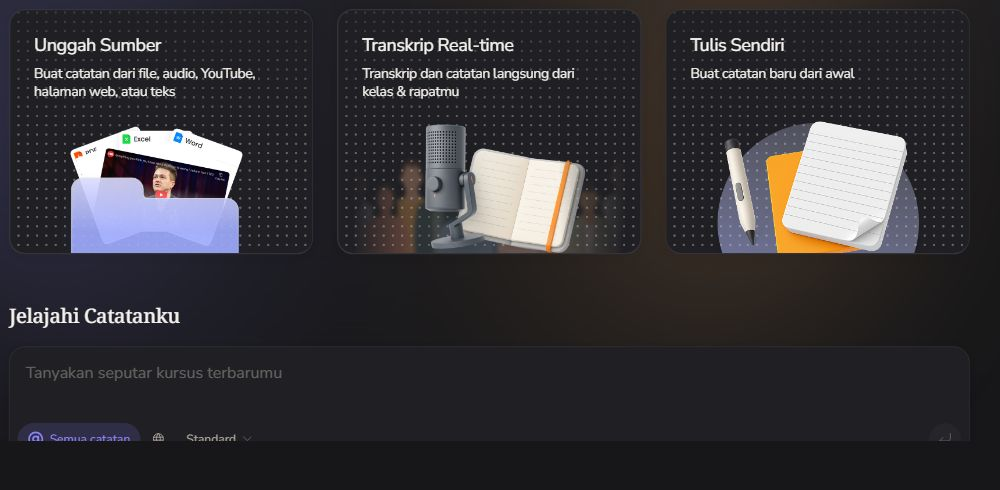
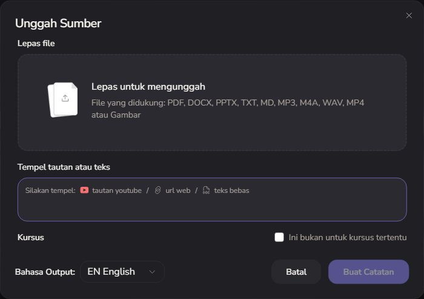
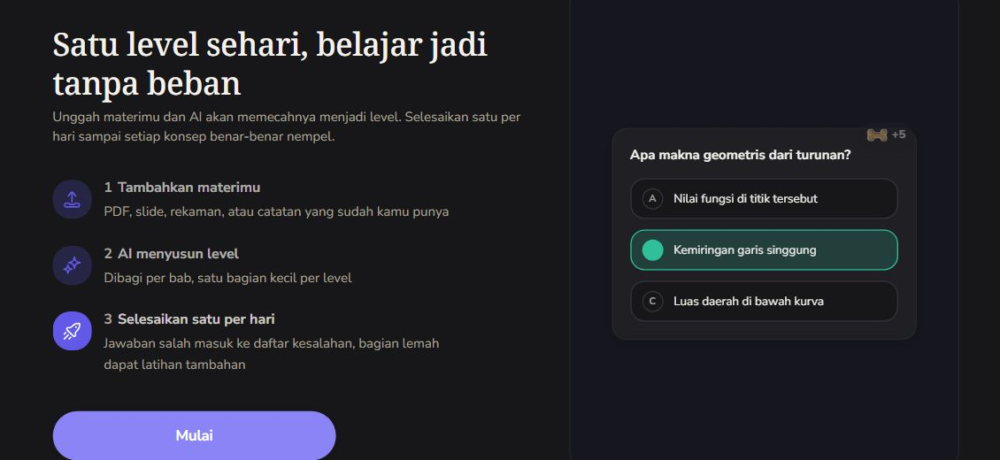

# Thetawave: competitor inspection and a focused direction for Personal Learning

Inspected 27 October 2026. Research and recommendations only; no application changes.

## 1. The decision

**Thetawave could replace our project for a student who mainly wants to turn course materials into notes, ask questions, and revise for exams.** Its breadth is already substantial. We should not compete by adding the same collection of generators.

More importantly, its visible Study hub describes daily learning levels, a mistake list, and extra practice for weak areas. Its official exam page also describes concept-level progress and readiness. Therefore, “personalized learning,” “adaptive practice,” and “we remember where you struggle” are insufficient distinctions. [Study hub](https://thetawave.ai/id/app/feed), [official exam generator](https://thetawave.ai/feature/exam-generator).

Our strongest **hypothesis to test** is a more explicit, restrained tutoring experience: **show the step where the learner became stuck, repair that step briefly, and check a changed problem without a hint.** Make the evidence visible, distinguish help from independent success, and allow the learner to correct an inferred difficulty.

This is a potential product focus, not a claim that Thetawave cannot do it. Its generated tutoring quality and full adaptive flow were not tested. We have relevant code, but no comparative learning-outcome evidence yet.

## 2. Evidence and limits

Labels throughout this document:

| Label | Meaning |
|---|---|
| O | Directly observed in the signed-in website during this inspection. |
| D | Described on an official product page; not verified end to end. |
| C | Present in our source/inventory; not a new live-provider benchmark. |
| P | Proposed change, with additional implementation or evaluation required. |
| U | Unknown or not tested; absence of observation is not proof of absence. |

Inspected the dashboard, source intake, language picker, Study introduction, the first two steps of its five-step learning setup, existing-material picker, notes library, an existing note workspace, source library and course-list empty state. The browser was returned to the dashboard.

No new AI generation, file upload, recording, subscription, trial, checkout or sharing was submitted. A synthetic algebra topic was typed into the setup wizard, but no learning path was created. Opening an existing note updated its last-viewed metadata; its contents and identifiers are deliberately excluded from this report and the saved images.

The note workspace exposed study-tool tabs, but opening “Explore all features” led to a subscription selector for this account. That limits this inspection: it does **not** establish that every tool is always paid, nor that the tools work well or poorly. Model latency, streaming, cancellation, generated answers, quiz scoring, spaced repetition and source fidelity remain untested. Desktop inspection used a 1280 × 575 viewport; phone, keyboard-only, screen-reader and reduced-motion behavior were not comprehensively audited.

Three bounded interface crops were saved. Later screenshot attempts timed out while DOM inspection remained usable; no missing screenshots are represented as evidence. These images document observed UI, not generated mockups.

## 3. Features we can take—and what we already have

Our current implementation is the integrated Starlette/vanilla-JavaScript browser app, not the separate interface preview or legacy Streamlit app. See [current architecture](../handoff/CURRENT_ARCHITECTURE.md) for exact control IDs and implementation boundaries.

| Feature | Thetawave evidence | Our current position | Decision |
|---|---|---|---|
| Broad material intake | O: file, audio/video, image, URL and text entry points. Successful extraction not tested. | C: document/text/public-link intake; audio/video depends on configured transcription. Practice-reasoning images use a separate pipeline. | Borrow the unified intake organization. Advertise only formats our specific pipeline supports. |
| Intent before generation | O: exam/homework/understanding/notes/practice presets fill an editable learning-goal field. | C: free-form goal and optional learning pattern. | Adopt editable intent shortcuts inside intake; keep the goal itself editable. |
| Reuse existing material | O: setup can choose notes, courses or folders, with search and selection counts. | C: account resources and one resource reference on a course; not equivalent to a multi-source collection. | A useful later extension. Requires explicit source associations and limits, not just checkboxes. |
| Source-grounded chat | O: dashboard “all notes” scope and a note-side tutor. D: grounded answers. | C: source and current objective context, scoped saved question branches. | Make current scope visible; do not call source-grounded chat unique. |
| Structured daily learning | O: Study introduction describes chapter levels and daily sessions; only early setup inspected. | C: approved curriculum, lesson/practice/diagnostic/repair progression. | Relevant overlap. Improve the continuity of our loop rather than merely adding a level counter. |
| Mistake-focused practice | O: Study introduction explicitly describes a mistake list and extra weak-part practice. D: exam-prep positioning. | C: saved attempts, assessment evidence, repair and tentative learning signals. | Not a unique claim. Differentiate through understandable evidence and measured independent transfer. |
| Exam-date preparation | D: upcoming/past exams, material reuse, review plans and concept readiness. | C: free-form course/exam context; no equivalent integrated exam planner. | Defer until demand justifies calendar/scheduling work. Activity date filtering is not an exam planner. |
| Notes and multiple study outputs | O: Notes, Mind Map, Infographic, Quiz, Flashcards and Podcast tabs. D: generated outputs. | C: lessons, worked examples, practice, saved explanations and checkpoint exports. | Do not imitate six output tabs before six useful outputs exist. |
| Editable flashcards | D: card formats, deck-size choices and editing/add/regenerate controls. | No equivalent reviewed browser workflow. | Candidate after core tutor validation; every generated item should be editable if added. |
| Configurable quizzes | D: question formats, targeted topics, session lengths, explanations and history. | C: practice/assessment loop, not a general-purpose quiz builder. | Small topic-specific practice fits us better than a full quiz configurator initially. |
| Library organization | O: note search, course filter, sorting, select/bulk controls and folder/course actions. | C: resource keyword search and reference/note filters. | Borrow count/filter/empty-state clarity first. Folders and bulk operations require genuine repeated-use need. |
| Reusable source provenance | O: source-type tabs with counts; originating-note relationship. | C: origin and extracted-text preview, with truncation limits. | Strengthen provenance and reuse; keep extraction limitations visible where relevant. |
| Output-language control | O: automatic plus explicit languages; source-intake default was English in an Indonesian UI. | C: automatic response language plus explicit per-course override. | Preserve our automatic default. Distinguish UI language, source language and reply language. |
| Focus room/live transcription | O: navigation and entry cards. Actual timer/recording not exercised. | No equivalent focus room; transcription is provider-dependent intake. | Defer focus-room expansion; it is not our tutoring wedge. |
| Sharing/export | O: controls in note workspace; resulting permissions/formats not tested. | C: authenticated MD/DOCX/PDF checkpoint downloads. | Keep portable checkpoints. Do not promise collaboration based on a visible Share button alone. |

Official feature descriptions supporting the untested output claims: [study assistant](https://thetawave.ai/feature/ai-study-assistant), [flashcard maker](https://thetawave.ai/feature/flashcard-maker), [quiz maker](https://thetawave.ai/feature/quiz-maker), [exam preparation](https://thetawave.ai/use-case/exam-prep). These pages describe capabilities, not independently measured learning gains.

## 4. Specific UI patterns worth borrowing

### A. Organize capture around the user's material



**O:** The dashboard separates upload, live transcription and writing from scratch. The visual examples help explain what those entry points do. The lower chat surface is a separate way to use existing notes.

**P:** Keep our large goal composer as the primary action. In its existing plus menu, make Upload a file, Paste a link and Paste text concrete and recognizable. Once a reference is chosen, show its name, type, extraction state, preview and removal action in a compact attachment row. Do not turn our homepage into three equally dominant competing start flows merely to resemble the competitor.

**Where:** UI-H02–H05/H10, UI-R intake and preview; `app/web/learning-ui.js`, reference handlers and `/api/resources`.

**Work:** Frontend for presentation/status/removal; backend only for additional supported sources or retained ingestion jobs. No new AI is needed for attachment metadata. Removing the selected attachment must not silently delete the account resource.

**Acceptance:** A user can identify the active reference before submitting, replace it without losing their goal, and understand an extraction failure without losing the selected filename. Unsupported file types are rejected before an expensive operation.

### B. Intent chips should help users write, not secretly submit



**O:** The intake has file and text/URL paths, course association and output language. The optional goal presets inspected in the same flow populate an editable intent field; they are not all visible in this crop.

**P:** Offer a small number of optional intents such as Understand a concept, Prepare for an exam and Practice a weak step. Selecting one fills editable goal text and leaves focus there. The submit arrow remains the explicit generation action. Avoid an extra mandatory wizard for a simple typed goal.

**Where:** UI-H01/H07 and intake goal field; UI-P05 exam context only where appropriate.

**Work:** Frontend if the chip only edits existing fields. Passing new intent metadata or changing model behavior is backend/AI work and should be reviewed separately.

**Acceptance:** Clicking a chip makes no network generation request; the user can rewrite its text. Keyboard use and IME composition retain the existing Enter/Shift+Enter behavior.

### C. Show scope before the user sends a question

**O:** The dashboard chat distinguishes all-notes context; the note workspace has a tutor alongside the current note. This makes the same general chat interaction useful at different scopes.

**P:** A quiet scope label above our question composer should identify the course and current lesson, with a reference chip if present. Keep the sidebar question branches the user already requested. A reopened branch should explain its lesson context without requiring the user to remember which objective created it.

**Where:** UI-Q01–Q08, UI-N08/N09, source preview UI-R07.

**Work:** Frontend for labels using existing state. Broadening scope to multiple courses would change AI context, data retrieval and privacy boundaries; it is not part of this recommendation.

**Acceptance:** A learner can tell whether a question is about this lesson or another course before sending. Reopening a saved branch requires no new inference. A scope label must match the actual backend context, not imply full-document retrieval when only an excerpt was retained.

### D. Use tool tabs only when they switch substantial working surfaces

**O:** The note workspace offers study modes around the same material, rather than requiring a fresh upload per tool. Its tutor can coexist with reading.

**P:** Our Plan/Learn/Practice/Review navigation should stay attached to the course header, with a clear selected state and continuous layout. Keep one primary learning action within the current stage. For long source previews, a heading outline may help; a short lesson does not need a permanent table of contents. Do not add a blank Podcast or Mind Map tab to suggest parity.

**Where:** UI-L plan/lesson/practice/saved-step controls; central workspace in the separate `design_review/detail-study/` example before any integration.

**Work:** Frontend for navigation and reading structure; new generated outputs require backend contracts, persistence and AI cost decisions.

**Acceptance:** Switching views preserves course identity and expected reading position. The selected stage is evident without color alone. Browser Back returns to the expected view. A stage that has no content explains the next action rather than presenting an empty panel.

### E. Reuse sources without making users rebuild context

**O:** The existing-material picker separates individual notes, whole courses and folders; note selection includes search and selected counts. Source-library categories also carry counts and link material to an originating note.

**P:** Start with “Use an existing reference” in our current intake and retain a clear origin link. Later, add multiple-source selection only if learning tasks actually need it. A full multi-source design needs source IDs, ordering, removal semantics, bounded retrieval and answer provenance; visual checkboxes alone do not supply these.

**Where:** UI-H source menu, UI-B library, UI-R preview; resource/course data contract and `/api/resources`/`/api/courses`.

**Work:** Existing-reference picker can reuse storage; multiple-course source collections require backend/data work. Search by title/type needs no AI; semantic retrieval would be a separate measured addition.

**Acceptance:** Reusing material does not re-upload it or create a duplicate resource. A selected source remains identifiable in the resulting course. Account ownership is checked server-side, not merely by hiding other users' rows.

### F. Make empty states describe the actual empty condition

**O:** The Audio category had zero items while another source category contained material. Its message was generic. The course list showed “No courses found / Try adjusting your search terms” even without an entered search in this inspection.

**P:** Adopt category counts and filtering, but improve the copy:

| Condition | Appropriate copy/action |
|---|---|
| Whole library empty | No references yet. Add a reference. |
| Category empty | No audio references. Show all references. |
| Search has no matches | No matches for “[query]”. Clear search. |
| Request failed | References could not load. Retry. Keep current filters. |
| Date outside retained activity window | Explain the available history range; do not assert nothing happened. |

**Where:** UI-B01–B07 and UI-T01–T04. Current activity retrieval is capped at the newest 500 events; an empty old date is not proof of no historical activity.

**Work:** Frontend for accurate current-list states; complete historical date queries require backend pagination/date filtering.

**Acceptance:** Test empty library, empty category, no keyword match, fetch failure and an old activity date separately. Announce updated results without stealing typing focus.

### G. Preserve progress and give errors a nearby recovery action



**O:** Study setup reveals steps progressively. Continuing without material produced a specific inline error. Notes and sources also displayed actual loading text during retrieval. The daily-learning introduction explains the purpose of levels before setup.

**P:** Use a step counter only for genuinely multi-step work, such as a long import. Our goal-first start can remain one submission. For generation, place a compact status beside the pending assistant content or new plan, while leaving the user's goal visible. Distinguish Reading reference, Creating plan and Waiting for reply only when the backend exposes those stages; do not fabricate progress percentages or thinking steps.

**Where:** UI-H11/H14/H15, UI-Q08 and UI-R intake errors. See also existing detailed review recommendations rather than creating a parallel loading system.

**Work:** Frontend for existing request states; actual staged progress/cancel semantics require backend support. A visual Stop button is misleading if generation continues and is still billed.

**Acceptance:** At an artificial five-second delay, the user sees the pending action and retained input. A failure offers Retry or Edit near that action. Retrying does not duplicate a saved course or silently resubmit an attachment.

### H. Explain access limits before a user invests effort

**O:** Explore all features opened a subscription selector for this account. Escape on the selected pricing control did not dismiss that selector during this inspection; navigation away worked. That is a bounded observation, not a claim about every modal on the site.

**P:** If our eventual product has limits, show capability availability and material limits near the relevant action. Preserve drafts when sign-in or a limit interrupts work. Avoid presenting a free-looking generated output action that only discloses its gate after setup.

**Where:** account/auth controls, UI-H upload/generation, UI-Q sending and intake metadata.

**Work:** Frontend for messaging only if limits are already known; real quota enforcement and billing are backend/product work and not proposed for immediate implementation.

**Acceptance:** Users can leave an access dialog with keyboard and pointer, regain focus on its trigger, and recover their unsent goal. No trial or paid generation starts just because a discovery card was clicked.

## 5. Small visual and interaction details to keep deliberate

These are recommendations for our interface, not unmeasured claims that Thetawave passes accessibility or performance standards.

| Detail | Recommended behavior in our app | Verification |
|---|---|---|
| Icon rail | Familiar home/library/activity icons; visible tooltips and accessible names when labels are hidden. | Keyboard-focus each icon; inspect its accessible name. Collapsed Thetawave links lacked names in the captured AX representation, but this alone was not enough to diagnose their implementation. |
| Row hover | Hovering row text or its icon highlights the whole actionable row and triggers the same restrained icon motion. | Pointer over both regions; no motion on disabled controls. Keep the owner's upload/submit motion exceptions. |
| Active state | Route selection persists; hover disappears on pointer exit. Do not confuse visited/active/pressed styling. | Home → Library → Home with the pointer parked over the previous position. |
| Close controls | Center the icon and hit area independently; no translation that displaces the X. | Inspect both themes and enlarged text; Escape returns focus. |
| Reading surface | Retain Inter throughout, quiet sidebars and icy blue only for meaningful central-learning emphasis. | Check contrast in both themes; don't recolor every rail icon blue. |
| Input focus | Avoid the unwanted interior blue box while retaining a clear keyboard focus cue on the field/container. | Tab through fields; pointer click should not create a double border. |
| Language | Automatic by default; explicit override remains free text as requested. | Indonesian source + English user question; separately test explicit override. Don't silently copy Thetawave's observed English intake default. |
| Save state | Existing Save?/Saved behavior communicates dirty/clean state without repetitive success toasts. | Edit, save, failed save and dirty close; retain the draft on failure. |
| Hit targets | A comfortable roughly 44px touch hit area can surround a smaller visual icon; do not enlarge every desktop glyph. | Narrow/coarse-pointer tests, spacing and zoom. This is a web comfort target, not a claim that native pt/dp rules apply unchanged. |
| Motion | Meaningful sidebar entry/exit, brief hover feedback and reduced-motion alternatives. | Rapidly reverse a sidebar; no jump, trapped focus or hidden interactive controls. Avoid perpetual motion during lessons. |
| Tool menus | Anchored upload/export popovers, clear file-type icons, outside-click/Escape close and focus return. | Open at viewport edges, zoom and keyboard navigation. |

The separate interface example already demonstrates several of these details. That is not evidence that all are integrated into the current app. Avoid duplicating work already present in the preview; validate and integrate selectively after approval.

## 6. Can Thetawave replace us?

| Student's main job | Replacement risk | What would justify choosing us? |
|---|---|---|
| Turn lectures/materials into revision assets | High: observed breadth and official output claims cover this job well. | A narrow workflow advantage would need measurement; our present breadth is not stronger evidence. |
| Ask a source-based question | High: both products present this interaction. | Faster, clearer repair with less unwanted text, demonstrated on comparable material. |
| Prepare for an exam | Substantial: official exam planning and concept-progress claims overlap with our ambition. | Reliable independent performance improvement, not a different progress bar. |
| Find the precise reasoning move they misunderstand | Open question: our code is focused here; competitor's full diagnosis quality is untested. | Visible, correct step-level evidence plus a successful changed problem. |
| Resume an old difficulty without re-explaining it | Both can store learning artifacts; exact comparative experience untested. | A compact course → question tree and an immediately recognizable “continue this step” state. |
| Learn without having a source file | Our typed-goal route already supports this. The inspected guided Thetawave Study wizard required material at step two. | A smooth optional-source start. This is a difference in the inspected flow, not proof every Thetawave workflow requires an upload. |

We should welcome the uncomfortable result: for many students Thetawave may already be a better fit. Our project needs a clearly chosen learner and job, not an assertion that having fewer buttons makes it better.

**Proposed first audience:** learners who can follow an explanation but get stuck when doing algebra independently. This is a tractable starting segment because a changed problem can expose whether a specific repair worked. Broad multi-subject mastery claims would outrun our current checking capabilities.

## 7. A difference a user can actually notice

### In five seconds: show the job

P: In the learning area, a direct prompt such as **“Which step stopped making sense?”** with a small worked example communicates a more specific purpose than another general AI notes dashboard. Keep the broader learning-goal entry available; do not force everyone into a diagnostic form before their intent is known.

This message alone is positioning, not a product advantage.

### In thirty seconds: point to evidence

P: A learner enters:

```text
x + 3 = 8
x = 8 + 3
```

The tutor highlights the second line and responds briefly: “You added 3 on the right. Subtract 3 from both sides instead.” Then it asks for the corrected next line. Offer a longer explanation only when requested.

The UI should distinguish **“Possible difficulty: keeping both sides balanced”** from a confirmed diagnosis. Give the learner **“That's not where I'm stuck”** or an edit action. Do not turn a single mistake into a permanent label.

### In two minutes: demonstrate independent transfer

P: Ask a changed problem, such as `x + 4 = 10`, without exposing its answer. Record whether the learner solved it independently, used a hint or needs another check. Show that evidence in plain language instead of awarding “mastery” from one correct answer.

| Visible record | What it means | What it must not imply |
|---|---|---|
| Solved independently | Correct attempt before a hint in this problem. | Guaranteed long-term understanding. |
| Solved with a hint | Correct after help. | Equivalent evidence to independent success. |
| Recheck later | Evidence remains limited or inconsistent. | An automated diagnosis of ability. |

P: A later changed problem could test retention, but an integrated scheduled recheck still needs implementation. The legacy Streamlit spaced-review code is not the same as a working browser due-review feature.

**What already exists:** attempts with work, assessment, diagnostic response, repair, changed practice, saved question branches and tentative internal learning signals. `app/web_server.py` routes `attempt`, `diagnostic` and `practice`; UI-L12/L16–L18 and UI-W cover typed/attached reasoning.

**What needs more work:** reliable step alignment/highlighting, validated step-specific checking, explicit hint-use evidence, learner correction of inferred signals, conservative evidence summaries and scheduled browser rechecks. None should be claimed completed merely because a mockup depicts them. General model feedback is not a universal mathematical verifier.

## 8. Smallest useful roadmap

| Priority | Change | Type and location | Why this first / pass condition |
|---|---|---|---|
| 1 | Make scope and selected source unmistakable; improve empty/error states. | Frontend, UI-H10/UI-Q/UI-B/UI-T, using existing state. | Removes confusion without adding generators. Users identify source/scope and recover a failed action without lost text. |
| 2 | Make one algebra diagnostic episode excellent from attempt to changed practice. | Frontend + backend/checking/AI evaluation, UI-L/UI-W and tutor adapters. | Demonstrates our central claim. Wrong step is located accurately and the next task checks the same skill with changed values. |
| 3 | Add honest independence/hint evidence and a correctable difficulty observation. | Backend/data + UI; learning signals/attempt records. | Makes progress understandable. Helped success is not counted as independent success; corrections persist at the right course/lesson scope. |
| 4 | Add existing-reference reuse and editable intent shortcuts. | Frontend first; data contract if multiple sources are introduced. | Reduces repeated setup. No duplicate upload or unexpected generation. |
| 5 | Trial delayed checks and selected revision tools after user evidence. | Scheduling/data and possibly additional AI calls. | Retention or recall benefit must justify complexity and cost. Start with a small opt-in check, not a complete exam platform. |

Defer podcasts, infographics, a full flashcard editor, social focus rooms, large folder hierarchies and an exam-readiness dashboard until the selected audience demonstrates a need. An extra generator is not automatically a better learning experience.

No broader model context sharing is authorized by this research request. Any future proposal to send more learner history, step traces or additional source content must state the exact data, purpose and bounds before implementation. Existing scope restrictions still apply.

## 9. How to judge whether this would make us win

The word “win” should mean students prefer a demonstrably better learning episode. This review cannot predict hackathon judging or prove a commercial advantage.

Run a small exploratory comparison with approximately 5–8 target learners, using the same materials and comparable algebra difficulties. Counterbalance product order; do not compare our best curated example against an unfamiliar competitor default. Obtain appropriate access before testing generated Thetawave outputs; do not infer their quality from marketing or a paywall.

Measure:

1. Time until the learner can state what went wrong in their own words.
2. Correctness on a changed problem without a hint, separately from correctness after help.
3. Whether they can find and resume their earlier question.
4. Reading burden: answer length, skipped content and requests for clarification.
5. Incorrect or unsupported diagnosis, source mismatch and misleading confidence.
6. A delayed changed problem after 24–48 hours if practical.
7. Response time and cost per completed repair, including retries—not just cost per model call.

Before testing, set decision thresholds suitable for an exploratory trial. For example: no known incorrect diagnosis in the selected checked examples; at least 4 of 5 learners can explain the repaired step and finish the changed task; no more reading/setup time than the alternative. These are proposed gates, not measured results or statistically conclusive proof.

If the competitor already provides an equally clear repair with equal or better independent outcomes, do not relabel our implementation a moat. Narrow the segment, improve a measurable weakness, or reconsider the product's purpose. Source-grounded chat and attractive motion alone will not settle this comparison.

## 10. Applying the requested skills

### Karpathy Guidelines

| Principle | How it changes this recommendation |
|---|---|
| Think before coding | Separate observed behavior, official claims, current code and unknowns. Recognize the competitor's adaptive-learning overlap rather than assuming it is missing. |
| Simplicity first | Improve one coherent diagnostic loop. Reuse current menus, storage and question branches before adding a collection of output generators. |
| Surgical changes | This task changes documentation and saves research crops only. Recommendations map to existing controls; no framework migration, broad redesign or model-context expansion is implied. |
| Goal-driven execution | Define observable pass conditions for each UI change and a comparable learning task for the competitive claim. A screenshot alone cannot verify a tutoring advantage. |

Applied from the requested local [Karpathy Guidelines](C:/Users/raito/.codex/skills/karpathy-guidelines/SKILL.md).

### UI/UX Pro Max

Used the requested local [UI/UX Pro Max](C:/Users/raito/.codex/skills/ui-ux-pro-max/SKILL.md) for a targeted web-interface audit. This is not a new page or design-system request; no new palette or framework was generated. Our stack remains vanilla HTML/CSS/JavaScript, so React/native implementation advice was not substituted.

| Local query / guidance | Fit and application |
|---|---|
| `error clarity validation --domain ux` | Returned Web Focusable Error Summary and all-platform Error Messages. Use field-linked errors, announcement and purposeful focus for failed submission; no repetitive focus movement while typing. |
| `empty state recovery --domain ux` | Returned all-platform Empty States and Error Recovery. Distinguish filtered emptiness from an empty library; provide the relevant recovery action. |
| `progressive disclosure forms`, then narrower `progressive disclosure`, `--domain ux` | Both returned unrelated Heading Line Balance as the top result. Rejected it as evidence for form disclosure. Recommendations about optional setup use the skill's built-in Forms & Feedback priority guidance plus observed UI, not a verified search match. |
| Accessibility/interaction priorities in the skill | Keep visible keyboard focus, named icon controls, comfortable hit areas and loading feedback; verify our implementation rather than assume the competitor's implementation meets them. |
| Motion and navigation priorities | Preserve spatial continuity, reduced motion, expected Back behavior and deep links. Avoid an expanding visual system that obscures the learning task. |

Neither skill proves that users will learn better. They constrain the design process and make the proposed changes testable.

## 11. Evidence index and remaining inspection gaps

| Surface | Source | What was established |
|---|---|---|
| Dashboard | [Live dashboard](https://thetawave.ai/id/app/dashboard) | Entry cards, notes-oriented assistant and collapsed/expanded navigation. |
| Source intake | Dashboard → Upload source | Supported UI options, editable goal presets, language choices and disabled empty creation. No extraction test. |
| Study | [Study hub](https://thetawave.ai/id/app/feed) | Daily levels/mistake/extra-practice positioning and first two setup steps. |
| Learning setup | [New study setup](https://thetawave.ai/id/app/feed/new) | Topic, material selection, missing-material validation and existing-material picker. Steps 3–5 untested. |
| Notes | [Notes](https://thetawave.ai/id/app/notes) | Filters, loading, note workspace, study-mode controls and account-specific subscription interruption. No private note content reproduced. |
| Sources | [Sources](https://thetawave.ai/id/app/sources) | Type counts, search, source relationship and empty-filter wording. |
| Courses | [Courses](https://thetawave.ai/id/app/course) | Empty list and Create course entry. Creation not submitted. |
| Study outputs | [Official feature directory](https://thetawave.ai/feature) | Product-claimed breadth; not a generated-output test. |
| Exam workflow | [Official exam generator](https://thetawave.ai/feature/exam-generator) | Advertised exam-date, review and concept-progress overlap. |
| Our product | [Current architecture](../handoff/CURRENT_ARCHITECTURE.md), `app/web_server.py`, [existing UI review](UI_UX_DETAIL_REVIEW.md) | Current control IDs, diagnostic routes, scopes and implementation limits. Preview-only refinements remain separate. |

Further inspection worth doing only if it changes a product decision: one permitted generated lesson and incorrect-answer episode, actual review scheduling, quiz feedback/source references, mobile reading, keyboard dialog behavior and real error recovery. No paid access or additional private uploads were needed for the findings above.

**Recommendation:** borrow material reuse, editable intent presets, explicit context and clear filter/status behavior. Build our identity around an excellent, evidence-backed repair episode. Treat “we improve independent problem solving with less reading” as a claim to earn through comparison—not a slogan already established by our code.
