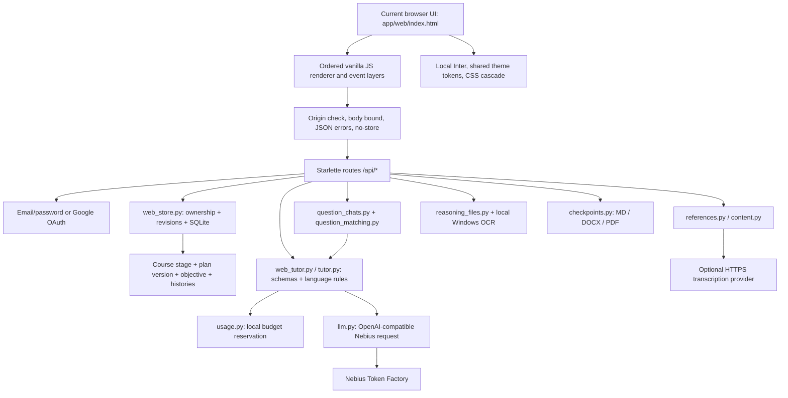
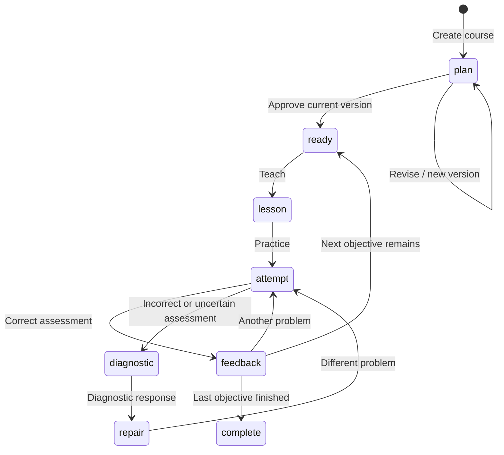

# Current project architecture and control inventory

## Current handoff — 2026-10-30.16 (30 October 2026)

OWNER Google OAuth callback dynamic resolution for tunnels and deployments: `app/web_server.py` now resolves Google's redirect URI through `google_callback_url(request)` instead of hardcoded local `request.url_for(...)`. It automatically recognizes `X-Forwarded-Proto` and `X-Forwarded-Host` (used by VS Code Port Forwarding tunnels `*.app.github.dev` and cloud container platforms like Hugging Face Spaces `*.hf.space`), while supporting explicit `GOOGLE_REDIRECT_URI` or `APP_BASE_URL` environment variable overrides and falling back to local `request.url_for` for direct access. Added test coverage in `app/tests/test_web.py` (`test_google_callback_url_resolution`). Documented in `docs/INTEGRATION.md` and recorded in `CHANGELOG.md`.

## Current handoff — 2026-10-30.15 (30 October 2026)

OWNER deployment preparation (Hugging Face Spaces Free Gradio-SDK / Docker + Private HF Dataset SQLite sync): added root `README.md` Spaces frontmatter (`sdk: gradio`, `app_file: app/hf_persistence.py`, `app_port: 7860`), `requirements.txt`, `packages.txt`, `Dockerfile`, `.dockerignore` and `app/hf_persistence.py`, plus offline regression suite `app/tests/test_hf_persistence.py` and deployment setup instructions in `docs/INTEGRATION.md`. `app/hf_persistence.py` wraps `uvicorn web_server:app --host 0.0.0.0 --port 7860 --proxy-headers --forwarded-allow-ips=*` (defaulting `COOKIE_SECURE=true` when `SPACE_ID` is present) and optionally synchronizes `workspace.sqlite3`, `usage.sqlite3` and `web-session.key` with a user-owned private Hugging Face Dataset (`HF_DATASET_REPO`, `HF_TOKEN`) using `sqlite3.Connection.backup` and SHA-256 change detection. No existing application code, routes, schemas, prompts, frontend assets, preview directories or legacy Streamlit files were modified. Live Hugging Face Space creation, remote dataset sync and live provider inference remain UNVERIFIED and require the owner's account credentials. Verification in CHANGELOG.

## Current handoff — 2026-10-30.14 (30 October 2026)

OWNER U19/P32/B01–B07: instruction language is pinned in system and user prompts independently of the subject's country/culture/language. Plan mismatch detection inspects title, scope, module titles/summaries and objective titles/outcomes; CJK/Arabic/Cyrillic in Latin-target plans is checked regardless of length, with Latin text checked from 18 characters. Short English country subjects and curriculum labels avoid known detector false positives. Non-bundled proposals get at most one language-only repair through the existing bounded, budgeted generator. IDs, membership/order, prerequisites, source identifiers, minutes, concept IDs and assessment flags must remain unchanged; persistent drift or changed structure fails safely with the draft preserved. This owner-authorized exception supersedes the blanket no-extra-call rule only for detected curriculum language drift; transport retries and model fallbacks remain disabled. Stored plans are not silently regenerated on load.

OWNER Plan/V08/P32: the final frontend enhancement removes both legacy numbered headings and their adjacent rich-text outcome DIVs. One semantic `.plan-learner-targets` list follows the scope note, with 13px bullet text and math rendering. Module lesson outcomes use the same compact bullet treatment. Standard and Cramming share this path, including repeated renders. Other architecture reviewed unchanged; verification in CHANGELOG.

## Current handoff — 2026-10-30.13 (30 October 2026)

OWNER plan-conflict correction P32/U19: strict normalization now treats a lesson's explicit module_id as authoritative when it names an existing module, rebuilding module membership lists and title accordingly. Conflicting lists with no valid explicit assignment remain rejected; track progression, grounding and approval checks still apply. Prompt explicitly asks the model to make both representations agree. Actual owner response was not inspected, so its precise mismatch remains unconfirmed. No retries or extra provider calls. Other architecture reviewed unchanged; verification in CHANGELOG.

## Current handoff — 2026-10-30.12 (30 October 2026)

OWNER UI-H/Library/Activity/V03/P28: the signed-in main header now uses a translucent theme-ground surface with backdrop blur, allowing the workspace notebook to show through the previously opaque top strip. The header remains distinct for readability; sidebar surfaces still cover the book. Other architecture reviewed unchanged; verification in CHANGELOG.

## Current handoff — 2026-10-30.11 (30 October 2026)

OWNER UI-A/UI-H/V03/P28: the browser favicon is a transparent icy-blue outlined book with crimson italic mathematical x/y, rendered as SVG. Signed-in workspaces now mount a separate large decorative Hairline notebook behind the main content; it remains viewport-centered while sidebars cover its edges. Its existing page animation and projected formulas are reused; lesson/other non-Home views use lower opacity and stronger blur. Main workspace background is transparent over the theme ground so the book is visible. Decorative figure is aria-hidden, non-interactive, theme-aware, removed on sign-out and its tour stops for reduced motion. This supersedes prior guest-only notebook-motion wording for the signed-in workspace; other architecture reviewed unchanged. Verification and limits in CHANGELOG.

## Current handoff — 2026-10-30.10 (30 October 2026)

OWNER V03/UI controls: shared enabled-button hover feedback now animates brightness and an inset boundary across static and dynamically rendered buttons, including dialogs, Library, Activity and course actions. Existing icon/transform feedback remains; upload/submit icons are not moved. Disabled controls are excluded. Language retains its arrow-only highlight. Reduced motion uses immediate color/boundary feedback, and hover rules apply only to hover-capable pointers. Other architecture reviewed unchanged; verification in CHANGELOG.

## Current handoff — 2026-10-30.9 (30 October 2026)

OWNER UI-H/U05: the three standard Home suggestion buttons lift and highlight on hover; reduced motion keeps the color feedback without movement. Their fill-only behavior is unchanged. Other architecture reviewed unchanged; verification in CHANGELOG.

## Current handoff — 2026-10-30.8 (30 October 2026)

OWNER UI-H17/U21: the second Cramming starter now says “I have presentation this morning” and inserts presentation context rather than exam context, including when a goal already exists. It still enables Cramming. Other architecture reviewed unchanged; verification in CHANGELOG.

## Current handoff — 2026-10-30.7 (30 October 2026)

OWNER UI-H08/UI-H16–17/U05/U21: Home's second composer layer follows the theme background with a thin contrasting outline. Personalize now has a person icon and an icy-blue outlined pill matching Cramming. Three standard suggestions sit above two Cramming suggestions; both Cramming options activate the same mode and preserve existing goal text. Light theme uses its background and a dark outline. Other architecture reviewed unchanged; verification is in CHANGELOG.

## Current handoff — 2026-10-30.6 (30 October 2026)

OWNER palette correction UI-P/UI-W/U07/P24: save and positive-state green styles now render icy blue; the practice and confirmation submit buttons render crimson instead of orange. The account avatar's teal is also blue. Theme variants and action behavior remain; Google identity and file-type colors are unchanged. Other architecture reviewed unchanged. Verification in CHANGELOG.

## Current handoff — 2026-10-30.5 (30 October 2026)

UI-H16/U21/P33: the Cramming toggle now matches Personalize's 36px desktop height and similar width; both retain 44px touch height on phones. Crimson, icon, animation and behavior remain unchanged. Architecture and other inventory reviewed without substantive changes; verification is recorded in CHANGELOG.

## Current handoff — 2026-10-30.4 (30 October 2026)

**LIVE code / offline FIXTURE verification.** Owner supersedes three-track selection (revision2026-10-29.12). Affected UI-H/UI-N/UI-P, FE-BOOT, U05/U19/U20 and new U21–U23, P32–P35, V01–V03/V09.

- New non-bundled standard proposals always use `advanced_full`:3–5 ordered modules /6–18 objectives spanning Beginner→Intermediate→Advanced. Intake/revision track cards, next-track previews and all manual extension buttons are removed. Module cards show level badges; approval and sequential lesson gates remain. Defaulted GeneralPlan.track_type=beginner still reads older JSON correctly; course creation/propose force new plans to full. Old saved plans are not migrated or replaced. Historical extension API/helper remains for compatibility, without a visible extension control.
- **U21 / UI-H16–17:** Home secondary strip has right-aligned crimson Cramming toggle and a matching fourth exam-tomorrow starter. Existing text is preserved with exam context, caret returns to its end. Exact book colors are #ed3e65 dark /#b41f43 light, with theme tint/border, short activation ring/icon motion and2.2s perimeter pulse. Reduced motion removes animation. No new motion library. Explicit `profile.cramming` is boolean, course-specific, included in guest pending payload and preserved through login/draft save. Urgent exam/test/quiz/cramming phrases also enable it server-side. Re-capturing the same guest goal refreshes its profile while retaining the request UUID; empty cancellation remains supported.
- Cramming always offers the existing editable intake by default, with exam-topic/weak-area/time/rules questions and Start cramming plan. Enhanced deterministic English clause extraction fills the supplied Calculus example without an extra model request; unknown phrasing stays editable. Cram proposals use exactly3 levels/modules and3–9 lessons, prioritizing exam essentials→standard problems→edge cases/drills. When an explicit numeric hour/minute allowance is recognized, summed generated lesson estimates cannot exceed it; failure preserves scope and requires manual recovery. Estimates are not a guarantee of exam readiness or actual study duration. Fixed bundled sample remains unchanged.
- **U22 / UI-N11/UI-P14:** pointer-captured separators resize history180–420px (default252) and pattern240–480px (default310). Arrow keys move the physical edge16px; Home/End set bounds; double-click resets. Width preferences stay in localStorage under personal-learning-sidebar-width / personal-learning-right-panel-width. Desktop main margins follow CSS variables; pattern width is capped when necessary to retain320px reading space. ARIA reflects rendered width/effective maximum. No resize affordance at<=760px history /<=1050px pattern; existing drawers/overlays remain. Drag disables width/margin transitions and text selection; cancellation releases that state.
- **U23:** course matching separates normalized core subject and residual specificity. Conversational prefixes, known domain anchors and>=.86 token spelling comparison (long words) accept machine learninng/machinne; extra subtopic tokens must also match. C/C++/C#/R/Go and supervised/unsupervised stay distinct. Matching returns the existing similar_learning choice without inference, account-owned only; Cramming and standard courses do not collide. This is a conservative heuristic, not semantic/embedding search; unknown wording may require Create separately.

Verification: **203 passed (115.80s)** full pytest suite, including12 auth/redirect scenarios and4 Cramming/theme/viewport scenarios, existing axe/regression checks, matching boundaries, scope edits, legacy defaults and preservation. Desktop1440×1000/phone390×844, plus constrained1051px resize: no horizontal overflow; pointer/keyboard/reset/persistence and reduced motion checked. New synthetic screenshots: `app/tests/artifacts/cramming/`; existing tracks regression screenshot paths were refreshed by that test and now show the current unified intake. No paid calls, new dependency/destructive schema change, protected configuration/private learner DB inspection, push or deployment. Real provider plan quality, Google consent and transcription remain UNVERIFIED. Local8780 started with the existing process-only main-route/$1 overrides; HTTP200 and current assets verified.

## Current handoff — 2026-10-30.3 (30 October 2026)

Rechecked the repeated guest-continuity/intake/tracks brief against LIVE source (UI-A/H, FE-BOOT, P32, U04/U19/U20). These features were already implemented in revision2026-10-29.12. Corrected one guest cancellation edge: entering auth with an empty/whitespace Home goal now clears the pending payload from memory and sessionStorage, so a deleted goal cannot be resumed after login. Failed login with a nonempty goal still preserves it. Existing API, intake/parser, track bounds, extension/version/ownership controls, previews and legacy architecture reviewed unchanged. Fresh isolated verification:24 tests passed, including12 headless auth/theme/viewport scenarios and four cancellation checks; details in CHANGELOG. No live-provider/OAuth-consent verification.

## Current handoff — 2026-10-30.2 (30 October 2026)

The three continuation documents now live together in root `handoff/`. Links and AGENTS.md were updated for the move. Architecture and application behavior reviewed; no semantic change.

## Current handoff — 2026-10-30.1 (30 October 2026)

Track-plan normalization now respects module `objective_ids` when individual objective `module_id` is absent. Previously those valid schema-defaulted objectives moved to the last module, collapsing Intermediate/Advanced into one module and falsely failing track limits. Per-objective and per-module mappings are reconciled; ambiguous/conflicting assignments fail safely. Counts, level progression, prerequisite and approval guards remain. Offline regression reproduced the exact error for valid Intermediate/Advanced fixtures before the fix. Actual owner response was not inspected; no live inference/private learner DB/env access. Other architecture, UI and preview inventory reviewed unchanged; verification in CHANGELOG.

## Current handoff — 2026-10-29.12 (29 October 2026)

**LIVE implementation; offline FIXTURE verification only.** Affected FE-BOOT, UI-A/UI-H, P32 intake, U04/U19/U20 and B01/B05; historical descriptions below are superseded where they differ.

- `live.js` captures a nonempty guest goal/profile/resource ID with a fresh request UUID before auth. Memory plus `sessionStorage['pending-guest-learning']` survives auth redirects. Successful email auth or authenticated boot waits for account lists, consumes/removes the stored payload before starting `createLearning`, closes the pattern panel and reuses its UUID. Failed auth keeps the pending goal. Consumption occurs after `perform` unlocks; cold boot waits for the learning script if necessary. Reload does not submit again. Real Google consent is not verified by the redirect simulation.
- Course creation now enters editable intake unless explicit skip/provisional/intake-completed flags are supplied. `interpret_scope` recognizes conservative English goal clauses for outcome, prior knowledge, time/deadline, requirements and depth. Existing explicit profile values win. Unsupported phrasing is left for editing, not inferred by an extra model call. All four scoping questions stay rendered; inferred values appear in profile/draft with a short prefill note. Clearing an intake value persists too.
- Three native-button cards use aria-pressed plus Selected/Select text, >=44px targets and neutral keyboard focus. Beginner: 1 module/1–5 lessons. Intermediate: 2–3 modules/6–12 lessons. Full: 3–5 modules/10–24 lessons, constrained by the existing 24-objective ceiling. GeneralPlan adds defaulted track_type/next_track_preview; CurriculumModule adds level/estimated_minutes. Existing JSON snapshots remain readable without a SQLite migration. Generated plan counts and Beginner→Intermediate→Advanced level order are validated; invalid responses fail without automatic retry. Workload minutes are recomputed from objectives.
- Intake cards select the track; Plan revision offers the same selector. Beginner plans show the next-track preview. Extend to Advanced path is available on plan/active/completion and saved-review surfaces for eligible non-bundled courses. `extend_curriculum` (also `revise` with target_track=advanced_full) appends new IDs, validates prerequisites/track limits, and retains original objectives/modules verbatim. The extension request sends the existing curriculum in addition to the existing profile/source/current-objective context; histories and attempts are not added to this context.
- Unapproved extensions update the plan directly. Approved extensions use pending_revision with extension/previous_count metadata and version checks. Applying retains histories, attempts, current lesson/question and objective_index; a completed course moves to the first added objective, ready to continue. Existing request deduplication/ownership/revision locking remains. The fixed bundled sample cannot extend; old courses too large for 24 lessons/5 modules receive a safe limit message.

Verification: `app/tests/test_learning_tracks.py` and `browser_tracks.cjs`; exact final results in CHANGELOG and [feature verification](../docs/qa/2026-10-29-learning-tracks.md). No paid calls, external dependencies, secret/private learner DB access, destructive schema change, deployment or push. Legacy Streamlit, preview inventories and unrelated U/P contracts reviewed unchanged. The server needs restart to load Python changes.

**Latest synchronization 2026-10-29.11, plan dialog:** revision button uses compact dialog treatment instead of the composer secondary strip; existing handler unchanged. Other architecture reviewed unchanged.

**Latest synchronization 2026-10-29.10, plan numbering:** ordered plan/revision lists rely on native numbering and displayed objective titles drop an existing numeric prefix; lesson cards retain one number. Stored data and other architecture unchanged.

**Latest synchronization 2026-10-29.9, learning/source and review:** OWNER removed course/source breadcrumb on learning screen (intake selection remains). Saved review recognizes NO_SOLUTION as missing; practice prompt discourages placeholder solutions. Origin of reported placeholder unverified; no live inference. Other architecture reviewed unchanged.

**Latest synchronization 2026-10-29.8, learning header:** OWNER removed the duplicate top-bar course title; page heading and stage navigation remain. Backend and other architecture reviewed unchanged.

**Latest synchronization 2026-10-29.7, practice/help:** removed redundant I need a hint button; Need help? still requests hint or focuses follow-up. Other overlapping shortcuts are documented in CHANGELOG. Backend and other architecture reviewed unchanged.

**Latest synchronization 2026-10-29.6, budget:** owner selected$1 local allowance; default usage.py now1.0 and current launch explicitly sets NEBIUS_BUDGET_USD=1. Existing cumulative ledger/reservation logic unchanged; not a provider billing ceiling. Other architecture reviewed unchanged.

**Latest synchronization 2026-10-29.5, API-ERROR:** assessment/diagnostic/repair/practice output ceilings increased from2048 to4096 after owner-reported length failure. Existing60s timeout, thinking setting, length rejection, no retry and budget controls retained. Other architecture reviewed unchanged; no live inference verification.

**Latest synchronization 2026-10-29.4, Activity/API-ERROR:** equal-height date/action row; local 8780 restarted with explicit process-only blank strong-model override to use main route. No .env edits or paid validation. Existing backend blank-to-None contract unchanged; other architecture reviewed unchanged.

**Latest synchronization: 2026-10-29.3, UI-Library/Activity/V01/P31.** LIVE frontend: root HTML canvas follows --ground and overview main fills viewport; duplicate overview header label hidden. Library uses compact search/New toolbar, existing filters and file-card grid with working list toggle; uploads/search/opening retained. Owner's supplied ChatGPT screenshot is the design reference. Provider 404 remains an external route/access issue; no configuration or inference changes. Other architecture reviewed unchanged.

**Latest synchronization: 2026-10-29.2 (29 October 2026), UI-04/V03/P31.** Owner requested removal of blue input outlines. Integrated final CSS now suppresses input/textarea/select outlines and retains neutral boundaries; other keyboard controls use grey theme focus tokens. This supersedes .1's blue-ring requirement. Other architecture and backend reviewed unchanged.

**Inspection date:** 27 October 2026, Asia/Jakarta. **Purpose:** describe the implementation that exists, including individual buttons, inputs, loading and error behavior. This is documentation, not approval to implement the companion recommendations.

**Handoff revision:** 2026-10-29.1. Integrated application fixes for QA-01–QA-06 and UI-01–UI-08 are described in the current revision section below. The original integration was realized on 28 October 2026 across `app/web/`, `app/web_server.py`, `app/web_tutor.py`, `app/web_store.py`, `app/episode_helpers.py`, `app/learning_history.py`, `app/review.py`, `app/review_selector.py`, `app/checkpoints.py`, and `app/schemas.py` (`V01`–`V09`, `U01`–`U09`, `U11`–`U16`, `U19`, `U20`, `B01`–`B06`, and `P32`). Historical notes remain dated. Do not present deterministic fixture checks as live-provider verification.

## Current revision — 29 October 2026, 2026-10-29.1

**LIVE code / offline FIXTURE verification:** QA-01–QA-06, follow-up interactions, UI-01–UI-08; affected UI-H/UI-R/Library/Activity/API-ERROR, V01/V03/V04/V09, P23/P31/P32. Later dated historical entries do not override this section.

- `llm.py` validates default/strong routes as one `nvidia/` Nemotron slug (letters, numbers, dot, underscore and hyphen), including directly constructed Settings. Syntax validation cannot confirm catalog existence or access. Provider 404 retains its model/setting diagnostic, zero retries and no fallback. No `app/config.py` exists.
- `web_tutor.py` direct answers use a 1,200-character schema and saved tone/teaching-style instructions: normally at most 90 words and one example, or four short steps when requested. The existing learner-question 1,536-token budget remains. Long prose lacking a terminal marker and unclosed code fences raise an incomplete-answer error; the last saved answer remains intact, and retry is manual. This is a heuristic plus transport length detection, not proof of semantic completeness or live-model compliance.
- Saved intake outcome/background remain editable; `missing` still lists unknown required fields only. Home draft/zero-objective cards say `Draft · Finish setup`.
- Shared `live.js` source dialog close refreshes Library list/counts; extraction errors appear as an alert inside the active dialog. Sidebar course IDs delegate reliably after reference selection; closed account menus synchronize `aria-expanded=false`. Activity's outside-window message requires at least 500 retained events and a selected date before the oldest event.
- Authoritative `step-repair-live.css` supplies both-theme action, muted, placeholder, keyboard-focus and required-control-border tokens. Pointer focus remains quiet; keyboard focus uses a 2px outline and 3px offset. Touch prose is 16px/1.5, metadata 12px/1.4 and enclosing controls at least 44px; SVG geometry stays unchanged. Light auth Back gets a final scoped override.
- Guest Hairline notebook has image semantics without changing its figure. Repair V04 wraps repeated lesson text in a closed, keyboard-operable `View lesson` disclosure with 16px gap, bringing the worksheet into the initial viewport. Equation font, lining numerals, baseline, crimson mark and non-color cues are preserved.

Verification artifacts and exact final counts: [QA/UI fix report](../.ui_review/2026-10-29-fixes/report.md) and root CHANGELOG; regression source `app/tests/test_defect_regressions.py` / `browser_defects.cjs`. Test configuration blocks protected `.env` loading and uses a synthetic session secret and temporary databases. **UNVERIFIED:** actual strong-route availability, provider adherence to brevity, Google OAuth and transcription. No paid requests, owner configuration/data changes, deployment or push. PREVIEW inventories, U10 PENDING, U17–U18 DEFERRED and legacy Streamlit semantics are unchanged.

## 0. Mandatory continuation package

Read this file, [UNREALIZED_CHANGES.md](UNREALIZED_CHANGES.md) and [UI_FEATURE_PROVENANCE.md](UI_FEATURE_PROVENANCE.md), then inspect project source before making changes. Together they define **actual implementation**, **exact desired interface/pending backend work**, and **origin/adaptation decisions**. Root `AGENTS.md` requires all three to be read before code changes and synchronized in the same task afterward. An unaffected document still receives an explicit reviewed/no-semantic-change record. Keep root CHANGELOG as chronology.

The latest focused proposal sample is **`design_review/proposal-feedback/`**, port **8769**: frontend waiting/recovery/source/empty-state suggestions from `ui_improvement_proposal.md`. Its shell/math baseline is **`design_review/step-repair/`**, port **8768**, including the final equation alignment correction. Sections15/15.5 describe these separate examples. The real application is still **`app/web/` + `app/web_server.py`**, port **8780**. Do not confuse a successful local sample UI with integrated backend capability.

Use UNREALIZED_CHANGES V01–V09 for exact geometry/copy/interaction, U01–U20 for pending implementation and B01–B07 for proposed backend contracts. Provenance P01–P31 explains inspirations and owner overrides. These IDs are specifications; proposed actions such as a future hint/correction endpoint are not existing APIs.

The companion [UI/UX detail review](../docs/UI_UX_DETAIL_REVIEW.md) references the component IDs in this file. Paths are relative to the repository root unless linked. Function names and selectors are intended as searchable implementation references. File line references in the symbol appendix are a dated snapshot, not permanent API identifiers.

## 1. Scope, evidence and execution boundaries

- **Current application:** [`app/web_server.py`](../app/web_server.py) serves [`app/web/index.html`](../app/web/index.html) and local `/assets/` files, conventionally on port **8780**. Starlette/uvicorn backend, vanilla JavaScript frontend, SQLite persistence.
- **Preserved legacy application:** [`app/app.py`](../app/app.py), Streamlit, conventionally port **8502**. It has a different session model, state machine and some features not exposed in the browser app. It is not an alternative renderer over the account database.
- **Design-only surfaces:** `design_review/winner-concept/` on8766, `design_review/detail-study/` on8767, `design_review/step-repair/` on8768 and focused `design_review/proposal-feedback/` on8769. These are not the current product and are not counted as implemented app features in sections2–14. Section15 explicitly inventories the examples.
- **Inspection fixture:** current production frontend and API code with temporary SQLite and deterministic model responses, on **8782** during this audit. A six-second artificial delay exposed loading placement; one synthetic model failure exposed recovery. These observations verify UI wiring, not real model accuracy, Google consent or transcription.
- **Source inspection:** backend routes, stores, prompt adapters, renderers, CSS cascade, source extraction, question routing, history and export code. No `.env` contents, credential values, private account databases or real chat bodies are reproduced.
- **Source precedence:** final loaded JavaScript and computed CSS win over earlier prototype definitions. In particular, literal mock account/lesson functions remain in early files but are replaced before normal account views open. Reading one early function in isolation gives an incorrect architecture.
- **Historical audit boundary (27 October):** the original inspection was documentation-only. Later LIVE revisions are recorded below; revision 2026-10-28.7 changes transport controls, metadata and Home spacing offline, without deployment, push, credentials access or paid inference.

## 2. System map

**Important absence:** there is no React component tree, frontend build server, WebSocket token stream, background job queue, vector database, semantic embedding search or provider-enforced cancellation endpoint in the current browser application. Plain HTTP requests return completed JSON. Local keyword matching is not an AI search service.

## 3. Frontend composition and override order — FE-BOOT

`index.html` contains the initial shell, inline CSS, goal input, basic sidebar, original preferences section and shared `<dialog>`. Scripts mutate these nodes and replace functions. This is an ordered global-script architecture, not independent modules.

| Load order | File | Current responsibility and precedence |
|---|---|---|
| 0 | `index.html`, inline script | Original DOM, sidebar toggle, base dialog helper, attachment-menu shell and sample navigation. Several handlers are later replaced. |
| 1 | `account-revision.js` | Moves the existing profile into a top-aligned right panel; creates auth and learning sections; defines language text override, account menu and signed/guest shell. Mock auth/lessons here are superseded by `live.js`. |
| 2 | `hairline-kernel.js`, `notebook.js` | Local Hairline runtime and notebook figure definition. |
| 3 | `workspace-revision.js` | Home/Library/Activity icon rail, theme persistence, guest-only notebook lifecycle, sidebar decoration, account dock and route/panel helpers. Sample Library/Activity implementations are superseded. |
| 4 | `folder.js`, `discovery-revision.js` | Hairline folder hover figures, whole-button SVG/symbol hover classes, mutation observer and cleanup. Sample filtering helpers are not the final account data renderer. |
| 5 | `experience.js` | Active rail selection, centered X, projected notebook formulas, delegated Enter/Shift+Enter/IME handling and mobile sidebar collapse. Its original question disclosure renderer is superseded. |
| 6 | `live.js` | Same-origin API wrapper, pending-operation coordinator, account restoration, real auth, real resource intake, course state rendering, Library/Activity and account-owned history. |
| 7 | `polish.js` | Dirty/saved preferences, save/discard dialog, checkpoint-format popover, click-away/Escape/arrow-key interactions and quiet helper text. Wraps `renderCourse` and `fillProfile`. |
| 8 | `vendor/marked.js`, `purify.js`, `katex.js`, then `reading.js` | Sanitized Markdown, protected math, limited marker cleanup, sentence capitalization, reading layout, removal of old course eyebrow. |
| 9 | `threads-ui.js` | Distinct file icons, collapsed sidebar question trees, compact first-question form, global-only new-learning preferences, final new-learning handler. |
| 10 | `chat-live.js` | Final question-chat renderer/action handler, Thinking wrapper, clarification/similar-question feedback, stale-feedback dismissal and validation-bubble suppression. |
| 11 | `practice-ui.js` | Practice reasoning attachment controls, extracted-text chips, orange Submit confirmation and dialog cleanup. |
| 12 | `learning-ui.js` | Base main submit handler; immediate generating view, similar-goal decisions, generation error/Back/Try again, language mismatch action and saved lesson/test review picker. |
| 13 | `step-repair-live.js` (+ `step-repair-live.css`) | Final live integration layer (`V01`–`V09`, `U01`–`U09`, `U11`–`U15`, `U20`): centered first-screen Home with bottom viewport divider, editable goal starters, searchable existing-reference picker and removable chip, docked stage strip (no Plan tick) and closed-default right panel on course entry, operation-scoped waiting/errors with `request_id` deduplication, white/black `Need help?` and durable `I need a hint`, 3-step repair micro-path (`Find the step` / `Repair it` / `Try independently`), validated code-point operator `<mark>` in `Times New Roman` lining/tabular numerals, correctable learner observation (`That's not where I'm stuck`), honest helped/independent outcome card, and counted Library/Activity empty states. |

CSS order follows the same development layers: inline → account → workspace → discovery → live → experience → polish → KaTeX/reading → threads → practice → learning. `workspace-revision.css` overrides the earlier system font with local **Inter Preview**, backed by `fonts/InterVariable.woff2`. The suffix “Preview” is a CSS family name; it does not mean the live app is using a fake font.

**Engineering consequence:** editing the first `home`, `auth`, `renderHistory`, `renderCourse`, `route`, `fillProfile` or `.send.onclick` definition may have no visible effect. Wrapper order and final handler assignment must be traced. This is a documented maintenance risk, not a request to refactor now.

### Browser state and persistence

| Variable/state | Scope | What it holds |
|---|---|---|
| `currentUser`, `capabilities` | Browser memory | Restored user/global preferences; Google/transcription/document capabilities. |
| `savedCourses`, `savedResources`, `savedActivity` | Browser memory | Account-owned API lists. Refresh fetches all three together. |
| `currentCourse`, `currentState` | Browser memory | Active course ID and public course snapshot. |
| `selectedReference` | Browser memory | One selected resource for the next course. There is no multi-source selector. |
| `pendingRequests`, `accountEpoch` | Browser memory | Suppresses duplicate operation keys and discards responses after account changes. |
| `savedPattern`, `preferenceKeys` | Browser memory | Snapshot used to derive Save?/Saved and restore discarded edits. |
| `openQuestionTrees` | Browser memory | User-opened sidebar branches; closed initially; not server-persisted. |
| `themeChoice` | `localStorage` | `personal-learning-theme`; light persists, otherwise dark default. No visible System theme option. |
| `attachments` inside `setupReasoningFiles` | Current form memory | Up to three selected extracted reasoning files; not a global upload manager. |
| `requestId` in chat form | Current composer memory | UUID regenerated on text edits; carried in chat request for server deduplication. |

There is no universal draft recovery store in localStorage. A preserved current DOM draft and a server-persisted submitted message are different things.

## 4. Current frontend control inventory

Each row names an actual interactive element or rendered state. “Local” means no API request for that action. Parent pending/error policies are detailed in section 6. Current CSS suppresses input blue outlines globally while button keyboard focus rules remain; this is not equivalent to a complete keyboard accessibility guarantee.

### 4.1 Guest, authentication and account — UI-A

| ID | Element / selector | Trigger and outcome | Backend / persistence | Important states |
|---|---|---|---|---|
| UI-A01 | Guest Log in | Opens email/password auth screen, removes guest notebook and closes pattern panel. | Local navigation. | Disabled until initial account/capability request completes. |
| UI-A02 | Guest Sign up | Opens signup form. | Local navigation. | Same boot restriction. |
| UI-A03 | Guest theme button `.guest-theme` | Toggles light/dark in one click. | localStorage only. | Next-theme accessible label/title updated. |
| UI-A04 | Guest notebook `.guest-notebook` | Pointer-responsive Hairline notebook with projected formulas. | No API. | Guest Home only; destroyed on auth/lesson/sign-in; reduced-motion respected. |
| UI-A05 | Continue with Google `.google` | If capability true, navigates to `/auth/google`. | OAuth redirect/callback, then login cookie. | Missing setup produces a technical fixed-bottom error; callback failure uses `auth_error` URL parameter and generic banner. Configured ≠ completed consent. |
| UI-A06 | Email `#live-email` | Required email input; `autocomplete=email`. | Included in auth POST. | Validation bubbles suppressed; invalid field gets `aria-invalid`. |
| UI-A07 | Password `#live-password` | Required password; signup min 10; max 200 server-side. | Never returned by API; stored as scrypt hash. | Signup `new-password`, login `current-password`. No visible password-reveal/reset control. |
| UI-A08 | Sign up / Log in submit `.auth-submit` | Auth POST, restore `/api/me`, fetch account lists, reset form, show Home and pattern. | `/api/auth/signup` or `/api/auth/login`. | Whole-body/dialog inert while pending; generic error banner on failure. |
| UI-A09 | Auth-mode alternative | Switches signup/login screen. | Local. | Form replacement, not preserved cross-mode draft storage. |
| UI-A10 | Back to learning | Returns to Home. | Local. | Does not authenticate. |
| UI-A11 | Account avatar `.avatar` | Toggles bottom-left account menu. | Local. | Initials derived from email; title Account; `aria-expanded` changes on direct toggle. |
| UI-A12 | Account settings menu item | Opens shared dialog with account email and preference/export guidance. | Local display. | No actual account-edit/delete/password-reset form. |
| UI-A13 | Appearance menu item | Now labeled Switch to light/dark theme; toggles immediately. | localStorage. | Former Light/Dark/System modal is obsolete. |
| UI-A14 | Switch account | Logs out, clears account arrays/course/reference/fields, opens login. | POST `/api/logout`. | `accountEpoch` prevents earlier responses being applied to the new account. |
| UI-A15 | Log out | Same cleanup, then guest Home. | POST `/api/logout`, invalidate cookie/token. | Success toast suppressed. |
| UI-A16 | Account-menu click-away | Closes menu when clicking outside account wrapper. | Local. | No common menu manager shared with all other popovers. |

### 4.2 Rail, history and Home composer — UI-N / UI-H

| ID | Element / selector | Trigger and outcome | Backend / persistence | Important states |
|---|---|---|---|---|
| UI-N01 | Home rail `[data-view=home]` | Opens new-learning Home; resets current course and local pattern fields. | Local; history arrays already fetched. | `.selected` and `aria-current=page` maintained. |
| UI-N02 | Library rail `[data-view=library]` | Shows resource search/list. | Local rendering of fetched resources. | Left and right panels hidden; rail retained. |
| UI-N03 | Activity rail `[data-view=activity]` | Shows date filter/events. | Local rendering of fetched events. | Accessible name View activity; same panel restriction. |
| UI-N04 | Sidebar toggle `.toggle` | Toggles closed/collapsed classes. | Local. | Sidebar hidden on guest; mobile collapses at ≤760px. |
| UI-N05 | New learning `.new` | Clears reference and goal, goes Home. | Local. | Universal tone/interests retained; struggle/context/language reset/hidden. No new course until submitted. |
| UI-N06 | Search learning `.search` | Filters course titles plus child question titles. | Local string search. | Matching child branches can be shown; clearing query restores open set. Not full-conversation semantic search. |
| UI-N07 | Course title `.course-title` | GET course, refresh lists, render course. | `/api/courses/{cid}` and three list GETs. | Screen retained until result; body inert; load errors shown in global error banner. |
| UI-N08 | Question chevron `.course-expand` | Toggles child list and `aria-expanded`; updates `openQuestionTrees`. | Local. | Only rendered for courses with questions; default closed. 28×28px box in current CSS. |
| UI-N09 | Question row `.question-history` | Opens saved thread in associated course. | GET course. | No model call simply to reopen; no shown timestamp/context menu/rename/delete control. |
| UI-N10 | Recent course card `.learning-card` | Opens one of two recent courses on Home. | Same load operation. | Stage/objective count is coarse progress, not measured mastery. |
| UI-N11 | History resize separator `.sidebar-resizer` | Drag, arrows16px, Home/End, double-click reset;180–420px desktop. | Local width preference only. | Hidden on phone; no API/model context. |
| UI-H01 | Goal textarea `.goal` | Free-form learning goal; Enter submits; Shift+Enter newline. | Goal included in course POST. | Empty final submit handler returns silently; server limit 700. Browser markup does not itself enforce the server's full profile boundary. |
| UI-H02 | Main plus `#add` | Opens reference menu anchored to composer. | Local. | `aria-expanded`; click-away. Explicitly excluded from icon-motion decoration. |
| UI-H03 | Menu Upload file `[data-source]` | Opens file-intake dialog. | No upload until Read file. | Authentication required; otherwise opens signup. |
| UI-H04 | Menu Paste link | Opens URL entry dialog. | No fetch until Read reference. | Public HTTP/HTTPS only when sent. |
| UI-H05 | Menu Paste text | Opens textarea dialog. | No persistence until Read reference. | Max 9,000 characters client/server; underlying parser requires at least 20 readable characters. |
| UI-H06 | Menu Try sample course | Opens sample-course dialog. | No model call to view. | Describes fixed algebra/substitution/coordinates sample. |
| UI-H07 | Main up-arrow `.send` | Final handler in `learning-ui.js`; immediately opens generating-learning view with typed goal as H1. | POST `/api/courses`; then refresh lists. | 44px circle/22px arrow target from current design; no generation on empty goal. Existing reference ID included. |
| UI-H08 | Personalize `.personalize` | Opens learning-pattern panel if signed in; otherwise signup. | Local. | Whole button hover; same panel as header opener. |
| UI-H09 | Header `#pattern-toggle` | Opens same panel. | Local. | Hidden while panel open; hidden on Library/Activity. This duplicates entry to a useful panel, not a second preference system. |
| UI-H10 | Selected reference `#source-state` | Reference title after selection. | Browser selected resource. | Empty/helper text suppressed; not a removable attachment chip with extraction status. |
| UI-H11 | Generating view `.generating-learning` | Goal heading + Thinking while curriculum request runs. | Same course request. | On success replace with plan; no token streaming. |
| UI-H12 | Similar-goal Open learning | Opens existing normalized-goal match. | GET existing course. | Server detects match before model call. |
| UI-H13 | Similar-goal Create separately | Repeats course creation with `similar_choice=new`. | POST courses; may invoke model. | Explicit duplicate creation, not silent deduplication. |
| UI-H14 | Similar-goal Back / generation-error Back | Returns Home and restores typed goal. | Local. | Uses closure over submitted payload. |
| UI-H15 | Generation-error Try again | Reuses captured payload. | Repeats POST courses; potential new inference cost. | Manual retry only; no automatic retry timer. |
| UI-H16 | Cramming toggle `#cramming-toggle` | Toggle course-creation mode, aria-pressed and crimson Home feedback. | Boolean in pending/course profile. | Urgent goal phrases also enable it; reduced motion static. |
| UI-H17 | Exam starter `.cramming-starter` | Enables Cramming, keeps existing subject or fills exam prefix; editable, not submit. | Local until main submit. | No model request on click. |

### 4.3 Right learning-pattern panel — UI-P

| ID | Element | Input/action contract | Storage and scope | Feedback |
|---|---|---|---|---|
| UI-P01 | Panel heading and top-right `.close-panel` | X closes if clean; opens discard dialog if dirty. | Panel state local. | 40×40px circle; 20px SVG; explicit centering overrides general icon motion. |
| UI-P02 | Where are you stuck? `#struggle` | **Textarea**, profile key `level`, max 700 server-side. | Course-specific. | Hidden and blank for new learning; shows saved course value inside course. |
| UI-P03 | Teaching style `#style` | **Textarea**, profile key `tone`, max 700. | Universal account preference; overlaid when courses load. | Free text, not fixed options. |
| UI-P04 | Interests `#interest` | **Text input**, max 200. | Universal account preference. | Same global overlay. |
| UI-P05 | Course or exam `#context` | **Text input**, max 300. | Current course only. | Hidden/blank for new learning. |
| UI-P06 | Language `.language-choice` | Text and right-hand chevron both open the existing editor. | Local until saved. | Automatic label by default; only arrow gets special hover background. Hidden for new learning. |
| UI-P07 | Reply language `#preferred-language` | Free-form text, max 80 server-side. | Current course profile. | Opens focused; not a fixed language dropdown. |
| UI-P08 | Language Apply | Updates language label, closes editor. | Changes draft, not server profile by itself. | Makes Save? dirty. |
| UI-P09 | Use automatic | Clears override and closes editor. | Changes draft. | Automatic uses language rules, not source-language assumption. |
| UI-P10 | Save?/Saved `.save-pattern` | Dirty derived from language/level/tone/interest/context/pace; POST atomic profile save. | `/api/profile`, optional current `course_id`. | Green Save? dirty; grey disabled Saved clean; no success toast. |
| UI-P11 | Discard changes | Restores `savedPattern`, closes modal and panel. | No save. | Red-tinted wide rounded control; text red in final stacked-dialog CSS. |
| UI-P12 | Confirm Save `.confirm-save` | Saves first; closes panel only after success. | Same profile endpoint. | Green tint; failed save retains draft/dialog. |
| UI-P13 | Keep editing `#done` in discard dialog | Closes dialog only. | Local. | First wide white button with dark text; discard and save below it. |
| UI-P14 | Pattern resize separator `.right-panel-resizer` | Drag or keyboard at>1050px;240–480px, reset310. | Local width preference only. | Narrow-screen overlay retained; effective width/ARIA capped for reading space. |

Profile has a `pace` key but the integrated panel does not expose a separate pace widget; `fieldsProfile()` supplies “One reasoning move at a time”. Universal preferences are only tone and interest. Account profile storage is not a second store for struggle/context/language.

### 4.4 References, files and link controls — UI-R

| ID | Control/state | Action and request | Limits/important detail |
|---|---|---|---|
| UI-R01 | Reference file picker | Native single-file input, aria-label Reference file. | Accepts PDF/DOCX/TXT/MD/SRT/VTT and listed audio/video suffixes. Native accept is a picker hint, not server validation. |
| UI-R02 | Read file | Checks file selected and overall 25MB threshold; posts FormData. | `/api/resources`; parser applies the stricter 2MB document limit. No visible per-file upload percentage. |
| UI-R03 | Reference link input | URL field. | Up to 2,000 characters; no credentials/private targets/nonstandard ports. |
| UI-R04 | Read reference for link | Sends `{kind:url,url}`. | Server fetch/extract, not client direct fetch; no YouTube visual analysis or arbitrary video-link downloader. |
| UI-R05 | Reference text input | Multiline pasted source, 9,000-character maximum. | Sends `{kind:pasted,text,title}` through Read reference. |
| UI-R06 | Add sample reference | Stores fixed bundled reference. | `{kind:bundled}`; no inference. |
| UI-R07 | Resource preview `.source-preview` | Shared modal with origin and extracted plain text. | Max-height 45svh, pre-wrap and scroll. Does not render source HTML/scripts. |
| UI-R08 | Excerpt warning | Shows when HTML text was truncated to the opening 9,000 chars. | Source preview does not promise full-document retrieval. |
| UI-R09 | Use this reference | Sets selected source, closes modal, returns Home. | Only shown when resource belongs to current saved Library list. |
| UI-R10 | Modal Close `#done` | Closes shared dialog. | Picker contents not a persistent upload draft. |

Main reference uploading and practice reasoning uploading are **different pipelines**, with different limits, endpoint, lifetime, and AI use. A visually similar plus button must not erase this distinction.

### 4.5 Plan, lesson, assessment and review controls — UI-L

| ID | Control | Behavior/request | Availability and preservation |
|---|---|---|---|
| UI-L01 | Course H1, source line, objective title/outcome | Render public state; Markdown/math sanitized for lesson copy. | Not editable course-title controls in integrated UI. |
| UI-L02 | View source `.inline-action` | Opens current source modal. | No model call; current source may be general goal rather than uploaded evidence. |
| UI-L03 | Accept this plan | POST course action `approve`. | Plan only; stores `approved_version=version`; moves ready. |
| UI-L04 | Request changes | Opens revision textarea modal. | Local until Revise plan. |
| UI-L05 | Requested plan changes | Textarea, max 700. | Draft sits in dialog. |
| UI-L06 | Revise plan | Captures text, closes dialog, POST action `revise`. | Replaces curriculum, increments version, resets approval/index/current lesson fields. Existing history retained separately. |
| UI-L07 | Regenerate in [language] | POST revise with constrained language repair instruction. | Only for flagged plan mismatch; new AI call and renewed plan approval. |
| UI-L08 | Teach me this idea | POST `teach`. | Ready UI; plan approval checked server-side. |
| UI-L09 | Worked-example ordered list | Renders all current example steps. | Integrated app does **not** expose the legacy “Show next worked step” control. |
| UI-L10 | Try a practice problem | POST `practice`. | Lesson UI; bundled exercises deterministic, general exercises model-generated. |
| UI-L11 | Your answer `#attempt-answer` | Required textarea, max 900. | Current form only until confirmed submission. |
| UI-L12 | Show your reasoning `#attempt-work` | Textarea, max 1,400 typed characters. | Supports separate extracted attachment text. |
| UI-L13 | Submit `.attempt-submit` | Opens confirmation, captures answer/work/attachment IDs. | Orange control; opening dialog itself does not assess. |
| UI-L14 | Confirmation Submit `.confirm-attempt` | Closes modal; POST `attempt`. | Whole page and open dialogs locked during request. Cancel keeps form values/attachments. |
| UI-L15 | Confirmation Cancel `#done` | Closes dialog. | No assessment request. |
| UI-L16 | Feedback section | Shows evidence, possible gap and diagnostic if needed. | Model gap interpretation is tentative; not mastery. |
| UI-L17 | Your next step `#diagnostic-response` | Required textarea, max 1,400. | Diagnostic stage. |
| UI-L18 | Help with this step | POST `diagnostic`. | Stores repair and auto-saved explanation note. |
| UI-L19 | Try a different problem | POST `practice`. | Repair stage; bundled chooses the changed variant. |
| UI-L20 | Next objective | POST `next`. | Correct-feedback UI only; server requires feedback; moves ready or complete. |
| UI-L21 | Try another problem | POST `practice`. | Correct feedback; does not advance objective. |
| UI-L22 | Start new learning | Returns Home. | Complete state. |
| UI-L23 | Review lessons and tests selector `.history-picker select` | Opens stored lesson/test view without mutating active course stage. | Created only when saved history/attempts exist; includes earlier-plan and recovered-note labels. |
| UI-L24 | Saved step options | Show explanation, example, practices/attempts/assessment/repair. | Current pre-attempt answer keys removed server-side; historical solution availability is restricted. |
| UI-L25 | All saved tests option | Shows stored attempt questions, answers, work and feedback. | Not an editable retake form. |
| UI-L26 | Return to current step | Re-renders original current course snapshot. | No rewind or model call. |

### 4.6 Practice reasoning attachments — UI-W

| ID | Control/state | Action | Backend/persistence |
|---|---|---|---|
| UI-W01 | Attach reasoning `.reasoning-add` | 36×36px plus opens two-option menu. | Local. |
| UI-W02 | Upload file in reasoning menu | Opens picker for `.md,.pdf,.docx`. | Local chooser first. |
| UI-W03 | Upload image in reasoning menu | Opens picker for PNG/JPEG/WebP. | Distinct magenta outline icon; not the main source upload. |
| UI-W04 | Hidden Reasoning attachment picker | On selection immediately posts selected file. | POST `/api/courses/{cid}/reasoning`; only allowed in attempt stage. |
| UI-W05 | Reading attachment… | Inline text beside attachment tools during extraction. | No spinner or true percentage; removed in finally. |
| UI-W06 | Filename chip | Opens extracted-text modal. | Shows exactly the retained extraction, not the original image/PDF. |
| UI-W07 | Remove [filename] X | Removes item from current form array. | Does not immediately delete the stored extracted-text DB row. |
| UI-W08 | Fourth-attachment error | Stops another selection at three files. | Global error banner; server revalidates count/ownership. |
| UI-W09 | Escape/click-away on reasoning menu | Closes menu; Escape returns focus to plus. | Listener aborted when form is removed. |

### 4.7 Question conversations, clarification and topic decisions — UI-Q

| ID | Control/state | Trigger and result | Request/data rules |
|---|---|---|---|
| UI-Q01 | Ask about this lesson heading and `#followup-question` | Starts one question branch attached to current objective. | Textarea max 1,000; visible label is hidden in compact CSS but accessible label exists. |
| UI-Q02 | Ask button | POST `question` with text and request UUID. | Approval required; exact/similar question logic can avoid inference. |
| UI-Q03 | Chat title | Original saved question text. | No auto-rename editing control. |
| UI-Q04 | Back-to-course button `.back-to-lesson` | Renders current course from loaded result. | Local; no model request. |
| UI-Q05 | Chat message `.chat-user/.chat-assistant` | Shows saved role and sanitized content. | Full saved log returned; request context is bounded separately. |
| UI-Q06 | Reply textarea | Single-line start, grows to 140px; max 1,000. | Enter submit; Shift+Enter newline; new UUID on edit. |
| UI-Q07 | Send chat reply | Up-arrow, 36×36px. Disabled for empty input or pending topic decision. | POST `chat`, thread ID, text, request ID. |
| UI-Q08 | Thinking indicator | Appears immediately before chat composer/first-question form; removed on completion. | Generic waiting state, not displayed model reasoning. |
| UI-Q09 | Similar-question feedback | Offers previous saved title and two decisions. | Matching is local deterministic normalization/fuzzy comparison within objective; not embeddings. |
| UI-Q10 | Open previous answer | Loads existing branch. | GET course; no inference. |
| UI-Q11 | Ask separately | Retries explicit request with `similar_choice=new`. | May invoke inference. |
| UI-Q12 | Clarification feedback | Short inline message; current text preserved. | Obvious keyboard smash rejected locally server-side before model; ambiguous model result also asks clarification. |
| UI-Q13 | Service-error feedback | Explains reply unavailable, saved chat unchanged. | HTTP-success response can carry `service_error`; no automatic retry. |
| UI-Q14 | Topic-decision card `.topic-decision` | Pending off-topic user text plus decision prompt; composer disabled. | Pending answer retained privately until Yes, not shown prematurely. |
| UI-Q15 | Yes | POST `chat_transfer`; generate new plan and atomically move pending question/answer into new course branch. | New course has no approved plan. Struggle/context reset; language automatic; global style/interests retained. |
| UI-Q16 | No | POST `chat_discard`; removes pending exchange; empty new thread removed. | Existing saved messages remain. |
| UI-Q17 | Ask in this learning | Recovery for a recognized generic difficulty question previously misrouted. | POST `chat_reconsider`; validates pending ID and narrow difficulty pattern. |
| UI-Q18 | Discard question | Removes recoverable pending question. | Same `chat_discard`; does not erase entire history. |
| UI-Q19 | Review and accept your new learning plan | Returns transferred course to unapproved plan screen. | Local renderer, approval still required for lesson actions. |
| UI-Q20 | Similar-feedback reveal | 1,200ms opacity/6px move, inert until finished. | Cancelled/removed immediately when composer text changes; reduced motion immediate. |

The checked-out code includes real scoped multi-turn chat, despite the earlier UI-only discussion. This document records the current implementation; it does not authorize adding or expanding AI context during this audit.

### 4.8 Library, Activity and exports — UI-B / UI-T / UI-X

| ID | Control/state | Behavior | Backend |
|---|---|---|---|
| UI-B01 | Search library `.live-search` | Live keyword search over resource title, retained text and origin; every space-separated term must match. | No search endpoint/inference; current resources fetched already. |
| UI-B02 | All category | Shows both references and notes. | Local. |
| UI-B03 | References category | Excludes `kind=note`. | Local. |
| UI-B04 | Notes category | Only auto-saved/saved explanation notes. | Local. |
| UI-B05 | Resource row | Full row opens plain-text source modal. | No separate arrow action; arrow removed. |
| UI-B06 | Resource type icon | Folder/library SVG or Hairline folder where installed. | Hover reacts from whole button. |
| UI-B07 | Filter status `.filter-status` | Count or no-match/empty guidance, `role=status`. | Does not distinguish all empty causes in wording. |
| UI-T01 | Activity date `#live-activity-date` | Native calendar; filters event timestamp by learner browser local day. | No date-query endpoint. |
| UI-T02 | All dates | Clears date and restores fetched events. | Local. |
| UI-T03 | Activity event row | Loads associated course. | GET course. Server list capped at 500 newest events. |
| UI-T04 | Activity count/empty text | Shows count/no activity on date. | An old date beyond fetched 500 may appear empty; not proof of no historical events. |
| UI-X01 | Download checkpoint as… | Opens format menu above trigger. | Local until choice. |
| UI-X02 | Markdown menu item | Navigates authenticated export URL `?format=md`. | Server constructs readable Markdown; not raw DB backup. |
| UI-X03 | Word menu item | Same with `docx`; blue Word-style outline. | python-docx document. |
| UI-X04 | PDF menu item | Same with `pdf`; red PDF-style outline. | ReportLab and available Unicode font. |
| UI-X05 | Menu keyboard controls | Escape closes/refocuses; Up/Down cycle items; click-away closes. | Local. Native browser handles file download. |

Existing exports include curriculum/progress, current/saved lessons, worked examples, repair and reference metadata. They omit question chats, assessment attempts, active practice questions and embedded state JSON. LaTeX becomes readable Unicode/linear math; this is not full equation-image/OMML export parity.

## 5. Backend route and action contracts

### 5.1 HTTP endpoints — API-01 through API-14

| ID | Method / path | Payload and return | Handler / important behavior |
|---|---|---|---|
| API-01 | GET `/` | HTML entry point. | `FileResponse(web/index.html)`; not an SPA deep-route router. |
| API-02 | GET `/api/me` | `{user:null|{id,email,profile}, capabilities:{google,video,documents}}`. | `me`; profile exposes only tone/interest. Capabilities describe configuration, not successful provider tests. |
| API-03 | POST `/api/auth/signup` | Email/password → `{ok:true}` and cookie. | `auth`; email validation, password length/hash, IP/email throttles, duplicate check. |
| API-04 | POST `/api/auth/login` | Email/password → same. | Constant-time digest compare; rotates previous session token. |
| API-05 | POST `/api/logout` | No semantic body → `{ok:true}`. | Revokes login hash, deletes cookie, clears OAuth session. |
| API-06 | GET `/auth/google` | Google redirect or setup-required redirect. | Authlib OIDC, scopes openid/email/profile, account chooser. |
| API-07 | GET `/auth/google/callback` | Success `/`, failure `/?auth_error=google_login_failed`. | Verify Google email/sub, match or create account, link same-email account, rotate login. |
| API-08 | POST `/api/profile` | Clean profile plus optional course_id → `{profile}`. | Transactionally save active full profile and universal tone/interest; validate ownership before account update. |
| API-09 | GET/POST `/api/resources` | List; multipart file; URL/bundled/note/pasted JSON → resource. | Throttled account intake and bounded extraction. |
| API-10 | GET/POST `/api/courses` | List summaries; `{profile,resource_id?,similar_choice?}` → course or similar-learning decision. | Normalized-goal check, owned reference selection, plan generation/validation, course/event persistence. |
| API-11 | GET/POST `/api/courses/{cid}` | Full public state; action JSON → updated state/thread or feedback. | `guarded_course` → `course`; owner/revision checks and hashed lock bucket. |
| API-12 | POST `/api/courses/{cid}/reasoning` | Multipart file → `{file:{id,name,text,kind}}`. | Attempt-stage/owner check; 2MB extraction; bind to exercise fingerprint. |
| API-13 | GET `/api/courses/{cid}/export?format=` | MD/DOCX/PDF attachment. | Owner-only export, no inference. |
| API-14 | GET `/api/activity` | `{events:[...]}`. | Account-owned newest 500 events. |
| API-ASSET | GET `/assets/*` | Local CSS, JS, Inter, KaTeX/vendor assets. | Static mount of `app/web/`, not project root or `.env`. |

### 5.2 Course action matrix — ACT

All POST actions pass shared account throttling. A single in-process lock bucket is acquired before handling the course; it covers GET too. Optimistic revisions protect SQLite writes. This is a supported single-worker coordination strategy, not a distributed lock service.

| Action | Required current state | Data / effect | Model call? |
|---|---|---|---|
| `approve` | `plan` | Set approved version; `ready`. | No. |
| `revise` | Recognized course, no explicit stage restriction beyond handler branches | Up to 700 chars; regenerate; version++; unapprove; index=0; clear current lesson/question/attempt/assessment/repair. | Yes. |
| `profile` | Existing owned course | Replace clean course profile. Global save normally uses API-08 instead. | No. |
| `teach` | Approved current plan | Generate current objective lesson; `lesson`; auto-note. UI exposes at ready, backend branch does not separately restrict to ready. | Yes. |
| `practice` | Approved + lesson/feedback/repair | New question; clear attempt/assessment/repair; `attempt`; new exercise_instance. | Bundled no; general yes. |
| `attempt` | Approved + attempt | Answer, work, owned attachment IDs; assess; append attempt; `feedback` if correct, otherwise `diagnostic`. | Yes, with deterministic check for bundled answer. |
| `diagnostic` | Approved + diagnostic | Up to 1,400 chars; repair; `repair`; auto-note. | Yes. |
| `next` | Approved + feedback | Increment objective; clear current fields; ready or complete. | No. |
| `question` | Approved current plan | First scoped branch; duplicate/similarity/clarification checks; save or pending decision. | Sometimes; skipped for deterministic feedback/reuse. |
| `chat` | Valid thread; allowed before new transferred plan approval | Same-thread messages; stable request UUID; bounded context. | Usually, except duplicate/clarification. |
| `chat_discard` | Valid matching pending ID | Remove pending; remove empty branch if necessary. | No. |
| `chat_transfer` | Valid matching pending ID | Generate new plan, then atomic old/new course update and transferred thread. | One plan call; pending answer reused. |
| `chat_reconsider` | Pending ID + narrow difficulty-question recognition | Re-run as in-course chat rather than treating general confusion as new subject. | Yes. |
| `hint` | Approved + `attempt` / `diagnostic` / `repair` | Record `hint_opened` assistance event on current `exercise_instance` in SQLite before returning hint text; update `state.episode`. Supports `request_id` deduplication. | No. |
| `correct_observation` | Existing owned course + matching `observation_id` | Append learner-selected focus (`operation`, `negatives`, `balance`) to `episode_observation` and `observations` without exposing private `learning_signals`. Supports `request_id` deduplication. | No. |

All course creation (`POST /api/courses`) and course mutation actions (`approve`, `revise`, `teach`, `practice`, `attempt`, `diagnostic`, `next`, `hint`, `correct_observation`) accept an optional client `request_id` and deduplicate completed responses (`creation_request_id` and bounded `completed_requests`, stripped in `public_state(state)`). `public_state(state)` also attaches `state["episode"]` via `app/episode_helpers.py:build_public_episode`, containing code-point-validated `work_sheet` lines/annotations, sanitized `observation`, `assistance`, and honest `outcome` classification (`correct_without_recorded_help`, `correct_with_help`, `repaired_needs_transfer`, `unresolved`). `BoundaryMiddleware` returns structured error JSON (`{error, code, retryable}`).

Question chats run alongside this stage machine. Reopening a question or historical lesson is not a stage transition. General-practice correctness is model-assessed; the bounded original sample has deterministic numeric/yes-no checks.

## 6. Loading, errors, keyboard and animation — FE-FEEDBACK

### 6.1 Operation coordinator

`perform(key, operation)` stores the operation key, captures focus, makes body and every open dialog **inert**, sets `aria-busy=true`, and writes Working… into `#live-status`. Final CSS hides every non-error live-status. It releases inert state/focus in finally. If the originally focused element no longer exists after a re-render, there is no general new-view focus target.

This suppresses accidental double submissions but blocks all page controls, including navigation, during requests. There is no clickable Stop/Cancel while globally inert, and no fetch AbortController or backend job cancellation endpoint. The browser application does not stream partial model tokens.

### 6.2 Current visible waiting/error matrix

| Operation | Visible waiting | Success | Failure |
|---|---|---|---|
| Boot/account restore | Auth controls disabled; body inert; old review-note is CSS hidden. | Correct guest/account view after lists arrive. | Fixed-bottom error; controls may remain disabled because enabling occurs only in successful operation body. |
| Email auth | Global inert; no dedicated per-button spinner. | Form reset, Home/pattern. | `#live-status.error`; draft DOM retained. |
| Generate curriculum | New goal-heading view immediately; Thinking below it. | Plan rendered. | Inline generation-error + Try again/Back. |
| First question / chat / topic action | Thinking before relevant composer; whole body inert. | Render saved thread/decision/result. | Inline `service_error` for model transport errors; other errors can use global banner. |
| Teach/practice/assessment/repair | Global inert; shared Working… hidden. | Render result. | Global banner; existing screen generally remains. No common visible Thinking wrapper for these base course actions. |
| Load course/history | Existing screen remains; global inert. | Whole view replaced. | Global banner. No explicit load-row skeleton. |
| Read reference | Open dialog inert; shared Working… hidden. | Preview dialog replaces intake. | Global error at viewport bottom, possibly under modal top-layer/backdrop. |
| Reasoning extraction | Inline Reading attachment… beside plus. | Filename chip; extracted-text preview available. | Global error; picker resets; answer/reasoning retained. |
| Save pattern | Save? disabled during operation; no toast. | Grey Saved. | Global error; dirty fields stay. |
| Export | Native navigation/download, no shared perform wrapper. | Browser download. | No custom per-format failure state in the frontend. |

Measured in the synthetic 1280px-wide browser: generation Thinking was 28px high, **13px label, 9px dot, 9px gap, 24px vertical margins** (`.generating-learning` override), at x≈456/y≈149 below the goal heading. Ordinary Thinking uses **12px vertical margins**. Dot animation is **1.3s ease-in-out**, opacity .3→1 and scale .7→1, with no animation for reduced motion. These are waiting visuals, not evidence that the provider is exposing chain-of-thought; transport explicitly disables Nemotron reasoning output.

Current global error banner: fixed at bottom 18px, horizontally centered, max `min(700px,85vw)`, 10×15px padding, 12px text, z-index 40, red-tinted border, pointer-events none, `role=status`. It has no dismiss/retry button. Shared dialog uses the browser top layer, so z-index alone does not solve modal error visibility.

### 6.3 Keyboard/input rules

- Enter submits the nearest form; invalid form focuses its first invalid field. Shift+Enter preserves multiline text. IME composing and keyCode 229 are excluded.
- Enter on main goal triggers final `.send` handler. In the right panel, input Enter triggers preference save unless the language form handles it first.
- Shared-dialog non-form text input Enter finds the first enabled `#dialog-body` button. This is structural button order, not an explicit semantic primary-action contract.
- `invalid` events suppress native balloons and set aria-invalid; input clears that attribute. There is no common field-adjacent validation-message component.
- Checkpoint popover supports Escape/Up/Down and click-away. Reasoning popover supports Escape/click-away. Main attachment/account/language controls do not all share this same keyboard contract.
- Buttons retain focus-visible outlines in base CSS. Inputs/textareas remove outline/box-shadow globally. A complete current-app keyboard/contrast audit is not claimed from this code inspection.

### 6.4 Motion and material

- Guest notebook: 320×256px desktop, 250×200px mobile. Two formula pages use icy blue/crimson, projected by Hairline page transforms. No guest scene while reading signed-in lessons.
- General eligible icon hover: 350ms cubic-bezier(.2,.8,.2,1), commonly translateY(-2px) and rotation -7°. Activity clock rotates +18°; Library icon rotates +7°. Whole containing button hover triggers it. Folder figure has its own pointer/focus driver and cleanup.
- Explicit exceptions: main upload `#add`, main `.send`, plus-menu descendants; centered X has transforms forced off. Later reasoning/upload icons may receive the generic class because exclusion is selector-specific, not semantic-role-wide.
- Text hover fill/borders transition around .16s. Account/avatar symbols can scale 1.08. Reduced-motion overrides remove nonessential transforms/transitions.

## 7. Layout and styling contracts — FE-LAYOUT

| Component | Current contract | Notes |
|---|---|---|
| Desktop rail | 64px fixed left; 44px rail buttons | Home/Library/Activity only; no rail search duplicate. |
| Sidebar | left 64px; width 252px | Main begins at 316px. Scrolls own history. |
| Right pattern | 310px desktop, top 0, padding 24px | Main normally gains right margin; at ≤1050px becomes an overlay with shadow. |
| Panel X | 40px target / 20px graphic, top/right 14px | Centering overrides generic transform. |
| Reading | max 740px; padding 28px; current margin-top 16px | Panel overlay can obscure reading at intermediate widths; responsive check needed. |
| Body/sidebars | Local Inter, mostly 13–16px | White course/question names in dark; theme tokens for light. |
| Theme dark | ground #000; surface #101114; raised #1a1b1f; ink #ededee; muted #a0a1a8; line #292a30 | Palette is owner-selected; do not replace with a winner's branding. |
| Theme light | ground #fff; surface #f5f5f5; raised #e9eaed; ink #202124; muted #62656c; line #dedfe3 | Formula and format-icon accents have separate darker variants. |
| Mobile ≤760px | Sidebar initially collapsed; rail hidden in ordinary collapsed Home, available in overview/navigation states | Rail 52px when shown; panel up to 340px/viewport. |
| Source preview | pre-wrap, max 45svh, scrollable | Plain text even when lesson supports Markdown. |
| Long math/code/table | Local horizontal scroll within rendered block | Prevent whole-page overflow; not arbitrary shrinking. |

## 8. Persistence/data model — DATA

### 8.1 Account database (`WEB_DB`)

Default `app/local_results/workspace.sqlite3`; protected ignored local file, never a static asset. Tables are created on connection. JSON snapshots provide most domain structure; no ORM or dedicated per-message table.

| Table | Columns | Role/ownership |
|---|---|---|
| `accounts` | id PK, email UNIQUE, password, google_sub UNIQUE, profile | scrypt password or Google identity; profile JSON contains universal tone/interests. |
| `logins` | hash PK, owner, expires | SHA-256 of random cookie token; seven-day expiry; raw token only client cookie. |
| `courses` | id PK, owner, state JSON, updated, revision | Owner filter on reads/writes; optimistic revision updates. |
| `resources` | id PK, owner, data JSON, created | Extracted references and explanation notes; no original uploaded file binary store. |
| `events` | id PK, owner, course, title, created | Activity title/time; no full event-sourcing replay. |
| `rate_limits` | key PK, count, until | Per-IP/email/model/reference/reasoning windows. |
| `reasoning_files` | id PK, owner, course, exercise, data JSON, created | Extracted file text and name/kind, bound to question fingerprint. |

Course snapshot fields: profile, source, resource_id, curriculum, version, approved_version, objective_index, stage, observations, attempts, review, review_history, created; optional lesson/question/exercise_instance/attempt/assessment/repair/metadata/followups/learning_signals/lesson_history.

Question thread: id, original question/answer, objective ID/title, created, messages with user/assistant content and user request IDs; optional pending `{id,text,goal,answer}`. Current model context uses only up to six messages from that thread. All saved messages can remain in the JSON log; this is not an unlimited provider context window.

### 8.2 Atomicity and safe public output

- `profile()` validates course ownership within BEGIN IMMEDIATE before changing either course profile or account universal preferences.
- `course()` overlays account tone/interests over that course's stored profile on load; it does not overwrite that course's struggle/context/language.
- `save_course()` uses revision in WHERE; concurrent overwrite fails with a reload message.
- `transfer_course()` updates old pending state and inserts the new course in one transaction after plan generation succeeds. Failure before transaction preserves original pending decision.
- `public_state()` deep-copies state; removes current question answer/solution, internal model metadata and learning_signals; strips pending answer. Historical answer/solution exposure depends on correct assessment or repair.
- GET course may auto-save an explanation note if not already present, and recover lesson history from matching saved notes in the returned state. GET is therefore not entirely side-effect-free with respect to note backfill.
- Note deduplication uses owner/exact text and deterministic IDs. Question chats are not automatically turned into Library notes.
- Reasoning binding uses SHA-256 of serialized current question. `exercise_instance` is separately recorded but is not included in this attachment fingerprint. Equivalent repeated questions therefore deserve a stale-attachment regression test before stronger “instance-bound” claims.

### 8.3 Other stores

- `LEARNING_USAGE_DB`, default `local_results/usage.sqlite3`: `calls` with purpose, model, started/state, estimated cost and token counts. Shared local meter, not per-account provider cap.
- `LEARNING_DB`, default `local_results/learning.sqlite3`: legacy Streamlit `learners` and `attempts`, keyed by hashed bearer session code. No automatic account migration.
- Local OAuth/session signing secret file or environment variable. Values never included in documentation. Theme is the only purposeful product localStorage preference currently identified.

## 9. Reference / reasoning / export processing — IO

### 9.1 Main reference pipeline

`UI-H03 → UI-R01 → Read file → API-09 → references.document → appropriate parser → store.add_resource → preview → Use this reference → selectedReference → API-10 resource_id`.

- Documents: max **2MB**; PDF max **12 pages**, readable text ≥35 chars, extracted source ≤9,000 chars, page-number labels retained. Scanned PDFs need OCR elsewhere; current main PDF reader does not OCR them.
- DOCX: bounded zip expansion **8MB**, paragraphs/tables extracted, no embedded-image understanding.
- UTF-8 TXT/MD/SRT/VTT: stored as text. Transcript upload does not need paid transcription.
- General `source()` min 20 readable chars and max 9,000; title ≤160 and origin ≤1,000.
- Public link: resolve DNS and reject non-global IPs, credentials and nonstandard ports; pin network connection to checked address with TLS hostname validation. Up to four attempts through redirects. 10-second per-connection timeout; download ≤2MB; accept HTML/text/PDF only. Remove script/style/navigation/footer/header/form; use main/article; opening text excerpt marked.
- Audio/video: recognized suffixes MP4/WEBM/MOV/MKV/MP3/WAV/M4A, ≤25MB and ≤5 minutes. Requires FFmpeg and all transcription settings plus explicit paid flag. Extract mono 16kHz audio in temporary directory; ignore visual frames/slides; HTTPS `/audio/transcriptions`, 120-second service timeout after bounded FFmpeg process. This capability is separate from text Nemotron and its local budget meter.
- Server request boundary is 26MB aggregate, with user-facing 25MB upload wording. Parser-specific document limits remain stricter.

### 9.2 Practice reasoning pipeline

`UI-W01 → file/image choice → API-12 → reasoning_files.extract → optional local OCR → reasoning_files table → filename chip → confirm Submit → attachment_ids → API-11 attempt → owned text combined with typed reasoning → assessment`.

- File ≤2MB; Markdown UTF-8, PDF ≤12 pages, DOCX ≤8MB expanded, images ≤12 megapixels.
- Images verified, converted RGB, resized within 2400×2400, written temporarily, passed to `ocr_image.ps1` with 35-second process timeout. Windows OCR runtime/language required; no paid vision model.
- Retained text ≤5KB per file; at most three IDs; combined typed+attached reasoning ≤6KB UTF-8. Text-only extraction can misread handwriting; filename preview is meaningful, not cosmetic.
- Only extracted text/name/type retained, not original file/image. Remove chip only removes current selection. No retention/deletion UI for orphan extracted rows was identified.

### 9.3 Export pipeline

`UI-X01 → format choice → API-13 → checkpoints.sections/readable_text/readable_math → MD/python-docx/ReportLab → Content-Disposition attachment`.

No inference, no new source retrieval. Common LaTeX fractions, roots, symbols, powers/subscripts and Markdown formatting are converted to readable plain representations; arbitrary math is not guaranteed typographic parity. PDF tries configured/local Unicode fonts then Helvetica. Long-term cross-platform font coverage needs actual document rendering tests.

## 10. AI transport, scope and validation — AI

- `web_tutor.py` handles general subject plans/lessons/practice/assessment/repair and scoped chats. `tutor.py` retains bounded original algebra-course logic and shared structured generation.
- `schemas.py` uses Pydantic `extra=forbid`. Bundled algebra plans retain three connected objectives; general plans support 1–24 objectives and optional module/concept hierarchy (revision .6); lesson explanation max 1,400 chars and 2–5 worked steps; assessment correct/incorrect/uncertain; repair max 4,000-char explanation.
- Chat return schema scope same_course/new_learning/clarify, new_goal ≤300, answer ≤2,400 chars. Explicit step-by-step requests select 2–4 structured steps, then app numbers them. Concision guidance normally 2–3 sentences for simple questions, usually under 150 words, up to 250 when necessary. These are instructions/schema limits, not a measured guarantee every model answer follows them.
- Language resolved from explicit override, otherwise latest learner message/answer/diagnostic then goal, fallback English. Local deterministic script/phrase signals and high-confidence langdetect; code excluded. Plan mismatch check is heuristic.
- Existing chat context: course profile/source, matching objective/current or saved lesson, up to six same-thread messages, new question and pending exercise prompt. No other chat body added. Non-chat generation may include last four same-objective requested-help signals, each evidence truncated to 350 chars. Questions are tentative help evidence, not private fixed-ability labels.
- Context bounding: for question_chat/general_assessment, reduce source text while >500 chars and drop oldest recent messages to fit allowance derived from 21KB minus schema/instruction size. Preserve learner reasoning or reject oversize; transport separately caps serialized messages/schema at **24KB**.
- `tutor.generate` supplies JSON schema, resolves output language, validates JSON; invalid model output raises a safe error. Schema validity does not establish factual/mathematical truth. Source IDs/prerequisite order checked separately.
- Bundled check: exact bounded numeric/yes-no checker, no eval. Wrong deterministic result cannot become correct via model. Correct numeric answer without reasoning may remain uncertain. General subjects lack a universal deterministic verifier.
- `llm.py`: fixed Nebius Token Factory endpoint; both configured model IDs must be NVIDIA Nemotron; live opt-in still required. Purpose limits: curriculum/lesson 4096 tokens and 120 seconds; assessment/diagnostic/repair/practice 2048 and 60 seconds; question_chat/learner_question 1536 and 60 seconds; other purposes 512 and 60 seconds. Explicit overrides must be integers within the purpose limit and absolute 8192 ceiling. `general_` purposes normalize to the same group. `max_retries=0`, existing length error and 24 KB transport input bound remain. Full response, not streaming. Settings never stores the API key; the request reads it locally.
- Meter still reserves **$0.01** per pending/unknown call. `NEBIUS_BUDGET_USD` defaults to **2.0**; blank uses default; finite positive values up to 100 accepted, invalid values raise SetupError. Nano route `nvidia/NVIDIA-Nemotron-3-Nano-30B-A3B` estimate is USD 0.06 input / 0.24 output per million tokens; Super route `nvidia/NVIDIA-Nemotron-3-Super-120b-a12b` estimate is USD 0.30 / 0.80, explicitly **UNVERIFIED**. Owner must confirm both against Token Factory console. Selected model is recorded in reservation and completion. Unknown routes/missing token counts retain reservation and cost None. This local estimate is not a provider/account billing ceiling and excludes other services.
- Prompt/source material treated as data, not instructions. Frontend renders lesson Markdown through DOMPurify allowlist and KaTeX with trust false/maxExpand 1000. Code blocks preserved; source preview stays literal. Known internal marker/currency cleanup is intentionally narrow, not a universal repair of malformed LaTeX.

### Optional transport settings (revision 2026-10-28.7, A1–A4)

| Variable | Default / blank | Example | Behavior |
|---|---|---|---|
| `NEBIUS_MODEL_STRONG` | No separate tier; use `NEBIUS_MODEL` | `nvidia/NVIDIA-Nemotron-3-Super-120b-a12b` | Curriculum, lesson, diagnostic, repair use strong tier; chat/practice/assessment retain default. Existing assessment also includes diagnostic questioning; no new inference/context was added. Default assessment preserves the requested cost behavior and existing deterministic bundled override, not a guarantee of general-subject correctness. |
| `NEBIUS_BUDGET_USD` | `2.0` | `5.0` | Positive finite number at most 100; same reservation transaction and pending-call behavior. |
| `NEBIUS_ENABLE_THINKING` | `false` | `true` | Only assessment/repair; these two gain 4096 tokens at 60 seconds. Other purposes always disable thinking. Invalid non-boolean text raises SetupError. |

Nothing breaks if the owner adds none of these optional variables. Existing key/model/live settings remain required for actual inference; no environment file change is required by this revision. Empty/reasoning-only content raises a safe ModelRequestError after usage is metered; separate reasoning fields are never shown, and leading think/analysis blocks are stripped. No automatic retry. Strong-route access, thinking compatibility, latency, output quality and rate accuracy are **NOT live-verified**.

## 11. API boundaries and error taxonomy — API-ERROR

Boundary middleware: reject cross-origin POST when Origin differs from request base URL; aggregate body bound; no-store, nosniff and same-origin referrer headers. The Origin check is not a complete production CSRF/session-security review. Login cookie HttpOnly/SameSite=Lax, Secure controlled by environment; OAuth session uses SessionMiddleware. No secret values are served.

| Category | Current status / payload | UI destination |
|---|---|---|
| Missing login | 401 JSON error | Global banner; no uniform automatic login redirect preserving current draft. |
| Invalid inputs/ownership/revision/locks/throttles | Usually 400 JSON error | Global banner or generation inline catch. Throttle is not currently a distinct 429 response with Retry-After. |
| Cross-site POST | 403 JSON | API wrapper error → global banner. |
| Model setup/budget/provider error | 400 safe error, except chat's handled feedback | Technical setup text may reach end users; no error-code/presentation mapping layer. |
| Similar question/clarification/service_error | 200 JSON feedback flags | Inline question feedback; not treated as saved successful assistant answer. |
| Similar learning | 200 JSON similar_learning | Generation view decision controls. |
| Google setup/callback error | Redirect query parameter | Generic global sign-in error. |
| Non-JSON/unexpected backend failure | API JSON parse fallback, often generic error | No structured request ID/support details. Unhandled programming errors not normalized by the narrow middleware catch. |
| HTTP download failure | Browser navigation result | No custom retry control bound to selected format. |

No arbitrary retry loops. Error copy should distinguish invalid user input, unsupported capability, wrong identity, rate/budget restriction, temporary provider failure and stale state. They are not interchangeable “try rephrasing” cases.

## 12. Legacy Streamlit inventory — LEG

This section is explicitly not part of the integrated browser UI. Its controls are included so “current project” does not accidentally omit the preserved implementation.

| IDs | Screen / individual controls | Behavior |
|---|---|---|
| LEG-H01–H03 | Learning goal textarea; Tailor my learning; Build my learning plan | Creates hashed-code session after nonempty goal; optional settings disclosure/jump. |
| LEG-H04–H08 | Teaching language select; Starting point select; interest text; Tone select; course/exam text | Legacy fixed options differ from integrated free-text style/struggle. |
| LEG-H09–H11 | Return to saved session expander; secret Session code input; Resume session | Bearer session-code access; not email/Google login. |
| LEG-R01–R06 | Reference radio (starter/paste/PDF); reference text; PDF uploader; Preview reference expander; Propose my plan | Restricted original course; saves source before generation. |
| LEG-L01–L05 | Editable Course title; each outcome textarea; Accept this plan; What should change?; Request a revised plan | Legacy plan editing is richer than integrated plan-only revision textarea. |
| LEG-L06–L11 | Teach me this idea; Show next worked step; Try it myself; Adjust explanation expander; Support radio; Adjust this explanation | Per-step reveal and pace regeneration exist here, not as current browser buttons. |
| LEG-W01–W04 | Answer text; reasoning textarea; Check my reasoning; Skip review and continue | Checked attempt records, independent/changed/review contexts. |
| LEG-F01–F04 | Correct-feedback Continue; diagnostic Your response; Help with this step; Try a different problem | Diagnostic repair retains evidence and help-used state. |
| LEG-C01–C04 | Try the review; Continue without review; Move to next idea; Relearn first flagged idea | Bounded due-topic selector; no measured retention claim. |
| LEG-S01–S08 | Session/preferences expander; Language; Interest; Explanation pace; Teaching tone; Starting level; School/exam context; Save preferences | Stored in legacy session snapshot. |
| LEG-S09–S11 | Editable teaching observation; Save observation; Delete observation | Correctable factual record tied to attempt ID/time. No matching browser observation-edit UI. |
| LEG-S12–S15 | Download Markdown checkpoint; Start separate session; confirm-delete checkbox; Delete session | Legacy export embeds full state/attempt JSON and differs from clean browser notes. Confirmed local session deletion only. |

Legacy stores: session code hashed SHA-256; `storage.claim` lease expires after 180 seconds; snapshot revision guards stale writes. `review.py` uses Asia/Jakarta dates, initial one-day intervals, doubling capped at 30 days for independent successful review, and relearning after repeated lapses. `review_selector.py` picks from taught/enabled/due approved concepts with fragility/overdue weighting and no replacement. Browser snapshots contain review fields but browser routes do not currently invoke this full legacy spaced-review workflow. Do not advertise it as integrated merely because the module exists.

## 13. Verification, dependencies and maintenance boundaries

- Python dependencies declared in `app/requirements.txt`; tests in `app/tests/`, pytest configured with `pythonpath=app`.
- Browser scripts in `frontend_tools/`: live integration, threads/chat, practice/OCR/export, question-feedback, navigation-feedback, learning-progress and older visual checks. Their existence is coverage evidence, not proof they were all rerun in this documentation pass.
- Current audit uses synthetic isolated storage and screenshots; no live inference test repeated. Previously reported test counts are deliberately not restated as fresh results.
- Delivery verification: all **79 application/prototype/tool source files** in the audit's initial SHA-256 snapshot remained unchanged. Both documents' relative file/image links resolved; the control inventory has **135 distinct UI identifiers**, plus grouped legacy controls, and the appendix lists **143 top-level Python functions/classes** across 22 modules. This verifies documentation references and the no-source-change boundary, not end-to-end production readiness.
- Local vendored Inter/KaTeX/Marked/DOMPurify, Hairline definitions/kernel; licenses included. Legacy homepage separately bundles GSAP/Lenis and scene assets under `app/frontend/`.
- `live_checks.py` and `check_nebius.py --live` are explicit paid probes, not routine read-only architecture commands.
- `.gitignore` excludes env secrets, databases, local_results, virtualenv, node_modules and private uploads. Ignoring is not encryption or a full retention policy.
- Runtime configuration names to understand, without values: WEB_DB, WEB_SESSION_SECRET, COOKIE_SECURE, GOOGLE_CLIENT_ID/SECRET, NEBIUS_API_KEY/MODEL/ALLOW_LIVE, LEARNING_USAGE_DB, LEARNING_DB, TRANSCRIPTION_BASE_URL/MODEL/API_KEY/ALLOW_PAID, CHECKPOINT_PDF_FONT.
- Restart backend for Python/env changes unless explicitly running a reload setup. Browser reload alone cannot restart the backend. This audit does not change or publish the existing service/tunnel setup.

### Audit conclusions about architecture, not requested fixes

1. The product already has many familiar controls; the largest detail gap is a consistent asynchronous operation/error/focus contract across those controls.
2. Shared global render wrappers and CSS overrides make small changes harder to predict. A future explicit module boundary can reduce regressions, but need not precede every visual polish task.
3. Search/date filters are local and bounded; loading full lists is simple today but requires pagination/search contracts if data grows.
4. Main references, reasoning attachments, and exports require different processing feedback. A single generic upload spinner would obscure meaningful differences.
5. Any stage/progress redesign must preserve plan-version approval and assessment gates. Visual familiarity cannot justify an unguarded “skip to Review” action.

## 14. Symbol appendix

The automatically extracted backend symbol map follows. It records every top-level application Python function/class in the inspected modules, including helpers that have no visible button. It does not enumerate third-party vendor internals or every nested closure; visible nested controls are inventoried above.

### `app/app.py`

| Symbol | Kind | Source line |
|---|---|---|
| `now` | function | [L20](../app/app.py#L20) |
| `save` | function | [L24](../app/app.py#L24) |
| `action` | function | [L28](../app/app.py#L28) |
| `start_question` | function | [L50](../app/app.py#L50) |

### `app/check_nebius.py`

| Symbol | Kind | Source line |
|---|---|---|
| `main` | function | [L8](../app/check_nebius.py#L8) |

### `app/checkpoints.py`

| Symbol | Kind | Source line |
|---|---|---|
| `readable_math` | function | [L9](../app/checkpoints.py#L9) |
| `readable_text` | function | [L27](../app/checkpoints.py#L27) |
| `sections` | function | [L44](../app/checkpoints.py#L44) |
| `export` | function | [L69](../app/checkpoints.py#L69) |

### `app/content.py`

| Symbol | Kind | Source line |
|---|---|---|
| `bundled_source` | function | [L24](../app/content.py#L24) |
| `questions_for` | function | [L29](../app/content.py#L29) |
| `pdf_source` | function | [L33](../app/content.py#L33) |
| `check_answer` | function | [L53](../app/content.py#L53) |

### `app/homepage.py`

| Symbol | Kind | Source line |
|---|---|---|
| `preview_markup` | function | [L10](../app/homepage.py#L10) |
| `scene_markup` | function | [L27](../app/homepage.py#L27) |
| `motion_markup` | function | [L37](../app/homepage.py#L37) |

### `app/language_rules.py`

| Symbol | Kind | Source line |
|---|---|---|
| `detect_language` | function | [L8](../app/language_rules.py#L8) |
| `resolve` | function | [L23](../app/language_rules.py#L23) |
| `plan_mismatch` | function | [L31](../app/language_rules.py#L31) |

### `app/learning_history.py`

| Symbol | Kind | Source line |
|---|---|---|
| `clear_current` | function | [L7](../app/learning_history.py#L7) |
| `record` | function | [L11](../app/learning_history.py#L11) |
| `public_history` | function | [L33](../app/learning_history.py#L33) |
| `recover_notes` | function | [L41](../app/learning_history.py#L41) |

### `app/live_checks.py`

| Symbol | Kind | Source line |
|---|---|---|
| `AssessmentProbe` | class/schema | [L15](../app/live_checks.py#L15) |
| `main` | function | [L35](../app/live_checks.py#L35) |

### `app/llm.py`

| Symbol | Kind | Source line |
|---|---|---|
| `SetupError` | class/schema | [L18](../app/llm.py#L18) |
| `ModelRequestError` | class/schema | [L22](../app/llm.py#L22) |
| `Settings` | class/schema | [L27](../app/llm.py#L27) |
| `ModelReply` | class/schema | [L34](../app/llm.py#L34) |
| `load_settings` | function | [L42](../app/llm.py#L42) |
| `request_math_help` | function | [L56](../app/llm.py#L56) |
| `request_model` | function | [L61](../app/llm.py#L61) |

### `app/question_chats.py`

| Symbol | Kind | Source line |
|---|---|---|
| `QuestionFeedback` | class/schema | [L9](../app/question_chats.py#L9) |
| `messages` | function | [L14](../app/question_chats.py#L14) |
| `respond` | async function | [L21](../app/question_chats.py#L21) |

### `app/question_matching.py`

| Symbol | Kind | Source line |
|---|---|---|
| `normalized` | function | [L6](../app/question_matching.py#L6) |
| `difficulty_question` | function | [L10](../app/question_matching.py#L10) |
| `unclear_input` | function | [L15](../app/question_matching.py#L15) |
| `clarification_answer` | function | [L27](../app/question_matching.py#L27) |
| `similar_question` | function | [L31](../app/question_matching.py#L31) |
| `goal_key` | function | [L49](../app/question_matching.py#L49) |

### `app/reasoning_files.py`

| Symbol | Kind | Source line |
|---|---|---|
| `extract` | function | [L13](../app/reasoning_files.py#L13) |

### `app/references.py`

| Symbol | Kind | Source line |
|---|---|---|
| `source` | function | [L25](../app/references.py#L25) |
| `document` | function | [L34](../app/references.py#L34) |
| `public_target` | function | [L63](../app/references.py#L63) |
| `PinnedHTTPS` | class/schema | [L80](../app/references.py#L80) |
| `read_url` | function | [L90](../app/references.py#L90) |
| `transcription_available` | function | [L138](../app/references.py#L138) |
| `transcribe_video` | function | [L142](../app/references.py#L142) |

### `app/review.py`

| Symbol | Kind | Source line |
|---|---|---|
| `today` | function | [L6](../app/review.py#L6) |
| `record` | function | [L12](../app/review.py#L12) |
| `due` | function | [L32](../app/review.py#L32) |

### `app/review_selector.py`

| Symbol | Kind | Source line |
|---|---|---|
| `select_reviews` | function | [L14](../app/review_selector.py#L14) |
| `main` | function | [L65](../app/review_selector.py#L65) |

### `app/schemas.py`

| Symbol | Kind | Source line |
|---|---|---|
| `StrictModel` | class/schema | [L8](../app/schemas.py#L8) |
| `Objective` | class/schema | [L12](../app/schemas.py#L12) |
| `Curriculum` | class/schema | [L21](../app/schemas.py#L21) |
| `Lesson` | class/schema | [L27](../app/schemas.py#L27) |
| `Assessment` | class/schema | [L32](../app/schemas.py#L32) |
| `Repair` | class/schema | [L39](../app/schemas.py#L39) |

### `app/storage.py`

| Symbol | Kind | Source line |
|---|---|---|
| `connection` | function | [L13](../app/storage.py#L13) |
| `key` | function | [L26](../app/storage.py#L26) |
| `create` | function | [L30](../app/storage.py#L30) |
| `load` | function | [L41](../app/storage.py#L41) |
| `save` | function | [L50](../app/storage.py#L50) |
| `claim` | function | [L61](../app/storage.py#L61) |
| `release` | function | [L66](../app/storage.py#L66) |
| `add_attempt` | function | [L71](../app/storage.py#L71) |
| `attempts` | function | [L76](../app/storage.py#L76) |
| `delete` | function | [L82](../app/storage.py#L82) |

### `app/tutor.py`

| Symbol | Kind | Source line |
|---|---|---|
| `generate` | function | [L12](../app/tutor.py#L12) |
| `propose` | function | [L35](../app/tutor.py#L35) |
| `require_approval` | function | [L59](../app/tutor.py#L59) |
| `objective` | function | [L64](../app/tutor.py#L64) |
| `teach` | function | [L69](../app/tutor.py#L69) |
| `assess` | function | [L81](../app/tutor.py#L81) |
| `repair` | function | [L106](../app/tutor.py#L106) |
| `export_checkpoint` | function | [L116](../app/tutor.py#L116) |

### `app/usage.py`

| Symbol | Kind | Source line |
|---|---|---|
| `BudgetExceeded` | class/schema | [L9](../app/usage.py#L9) |
| `connect` | function | [L13](../app/usage.py#L13) |
| `reserve` | function | [L21](../app/usage.py#L21) |
| `finish` | function | [L30](../app/usage.py#L30) |
| `summary` | function | [L41](../app/usage.py#L41) |

### `app/web_server.py`

| Symbol | Kind | Source line |
|---|---|---|
| `user` | function | [L43](../app/web_server.py#L43) |
| `cookie` | function | [L50](../app/web_server.py#L50) |
| `public_user` | function | [L55](../app/web_server.py#L55) |
| `limited_text` | function | [L60](../app/web_server.py#L60) |
| `clean_profile` | function | [L66](../app/web_server.py#L66) |
| `me` | function | [L72](../app/web_server.py#L72) |
| `auth` | async function | [L77](../app/web_server.py#L77) |
| `logout` | function | [L107](../app/web_server.py#L107) |
| `google_start` | async function | [L114](../app/web_server.py#L114) |
| `google_callback` | async function | [L120](../app/web_server.py#L120) |
| `profile` | async function | [L139](../app/web_server.py#L139) |
| `resources` | async function | [L150](../app/web_server.py#L150) |
| `public_state` | function | [L177](../app/web_server.py#L177) |
| `courses` | async function | [L197](../app/web_server.py#L197) |
| `course` | async function | [L227](../app/web_server.py#L227) |
| `guarded_course` | async function | [L313](../app/web_server.py#L313) |
| `activity` | function | [L325](../app/web_server.py#L325) |
| `reasoning_upload` | async function | [L329](../app/web_server.py#L329) |
| `export` | function | [L343](../app/web_server.py#L343) |
| `BoundaryMiddleware` | class/schema | [L351](../app/web_server.py#L351) |
| `signup` | async function | [L382](../app/web_server.py#L382) |
| `signin` | async function | [L383](../app/web_server.py#L383) |

### `app/web_store.py`

| Symbol | Kind | Source line |
|---|---|---|
| `now` | function | [L12](../app/web_store.py#L12) |
| `db` | function | [L17](../app/web_store.py#L17) |
| `password_hash` | function | [L38](../app/web_store.py#L38) |
| `create_account` | function | [L43](../app/web_store.py#L43) |
| `find_account` | function | [L50](../app/web_store.py#L50) |
| `login` | function | [L55](../app/web_store.py#L55) |
| `account` | function | [L63](../app/web_store.py#L63) |
| `logout` | function | [L69](../app/web_store.py#L69) |
| `throttle` | function | [L74](../app/web_store.py#L74) |
| `profile` | function | [L84](../app/web_store.py#L84) |
| `add_resource` | function | [L97](../app/web_store.py#L97) |
| `resources` | function | [L104](../app/web_store.py#L104) |
| `resource` | function | [L110](../app/web_store.py#L110) |
| `create_course` | function | [L114](../app/web_store.py#L114) |
| `transfer_course` | function | [L121](../app/web_store.py#L121) |
| `course` | function | [L132](../app/web_store.py#L132) |
| `save_course` | function | [L144](../app/web_store.py#L144) |
| `_save_explanation` | function | [L153](../app/web_store.py#L153) |
| `ensure_explanation` | function | [L168](../app/web_store.py#L168) |
| `exercise_key` | function | [L174](../app/web_store.py#L174) |
| `add_reasoning_file` | function | [L178](../app/web_store.py#L178) |
| `reasoning_files` | function | [L188](../app/web_store.py#L188) |
| `courses` | function | [L200](../app/web_store.py#L200) |
| `event` | function | [L206](../app/web_store.py#L206) |
| `events` | function | [L211](../app/web_store.py#L211) |

### `app/web_tutor.py`

| Symbol | Kind | Source line |
|---|---|---|
| `GeneralObjective` | class/schema | [L10](../app/web_tutor.py#L10) |
| `GeneralPlan` | class/schema | [L19](../app/web_tutor.py#L19) |
| `Practice` | class/schema | [L25](../app/web_tutor.py#L25) |
| `Followup` | class/schema | [L31](../app/web_tutor.py#L31) |
| `ChatReply` | class/schema | [L35](../app/web_tutor.py#L35) |
| `chat` | function | [L55](../app/web_tutor.py#L55) |
| `generate` | function | [L99](../app/web_tutor.py#L99) |
| `propose` | function | [L122](../app/web_tutor.py#L122) |
| `teach` | function | [L139](../app/web_tutor.py#L139) |
| `practice` | function | [L145](../app/web_tutor.py#L145) |
| `assess` | function | [L154](../app/web_tutor.py#L154) |
| `repair` | function | [L160](../app/web_tutor.py#L160) |
| `followup` | function | [L167](../app/web_tutor.py#L167) |

## 15. Separate interface examples and latest executable reference

This section describes **PREVIEW code**, not the integrated browser app. It was added for the three-file handoff on28 October2026. The preceding live-app inventory is intentionally separate.

### 15.1 Surface and source composition

| Example | Entry / port | Current status |
|---|---|---|
| Winner concept | `design_review/winner-concept/`,8766 | Earlier research experiment, not canonical for latest corrections. |
| Detail-study | `design_review/detail-study/index.html`,8767 | Earlier full interaction example with sample state/error/export flows and six UI/UX refinements. Source of the reused shell. |
| **Step-repair** | **`design_review/step-repair/index.html`,8768** | Latest canonical interface example. Thetawave-informed context/source changes, exact-step sample episode and final aligned/simplified equations. |

All are separate from `app/web/`. Serving one does not start/restart the main app or change its account state.

| Latest-preview file, in order | Responsibility |
|---|---|
| `index.html` | Preview bar, rail, course-history sidebar, main/header, pattern panel, scrims, shared dialog and live-announcement node. |
| `style.css` | Base dark/light tokens, local Inter, layouts, forms, rail/history/panel, chat, library/activity, menus/dialogs and base breakpoints. |
| `learning.css` | Central-only icy-blue accents, docked stage strip, worked-example/composer/export styling. |
| `motion.css` | Retained small placeholder; not the source of actual sidebar animation. |
| `refinements.css` | Navigation focus styling, invalid field boundary,44px touch targets and16px mobile/coarse-pointer reading/input text. |
| **`concept.css` loaded last** | Exact repair UI, latest equation stack/font/baseline, source context, existing-reference selected state, Home continuation, counted filters and mobile action stacking. |
| `navigation.js` | `createPreviewNavigation`: hash view/sample IDs, in-memory visit snapshots, browser Back/Forward, dirty-navigation restoration. |
| `script.js` | Global selectors/icons/state/resources/events, shell, menus/dialogs, guard/save, sidebar motion, original renderers, static sample replies/intake/export and navigation bootstrap. |
| **`concept.js` loaded last** | Captures original Home/chat/library renderers; overrides episode/Home/chat/library/source-menu/about; adds local `repair` object and final initialization. |
| `InterVariable.woff2`, `FONT-LICENSE.txt` | Local licensed UI font. Short equations use installed Times New Roman/serif with lining/tabular digits; this differs from UI Inter. |
| `samples/` | Static sample checkpoint MD/DOCX/PDF. Never substituted for real authenticated exports during integration. |
| `check.cjs`, `verification.json` | Repeatable isolated interaction/axe checks and recorded result. Reads existing frontend_tools dependencies, no real inference. |
| `screenshots/` | Evidence of sample states. `equation-output.png` and equation-theme-width crops supersede older captures for final math typography. |

The latest example reuses global scripts rather than importing production modules. Its functions with names similar to production are independent implementations. A future framework port must preserve observable contracts; this handoff does not require or authorize a framework migration.

### 15.2 Preview state and rendering

| State | Owner / lifetime | Meaning and limitation |
|---|---|---|
| `state.view`, progress/approved/historyView | Browser memory | Home/lesson/plan/chat/library/activity/complete and sample curriculum gating; not server authorization. |
| `state.source`, goal/courseTitle | Browser memory | One sample selected reference and typed goal. Arbitrary goal still produces fixed algebra plan with simulation label. |
| `state.global`, local/saved/coursePattern | Browser memory | Style/interests versus course struggle/context/language; dirty snapshot. Real app must keep atomic account/course profile semantics. |
| `state.threads` / thread.operation | Browser memory | Fixed initial chats, generated local IDs, drafts, waiting/error/topic sample behavior; no persistent chat database. |
| `state.libraryQuery`, filter/date | Browser memory | Filters over a fixed sample resource/event array; no external fetch or semantic search. |
| `repair` | Browser memory, `concept.js` | `step`, nextLine, answer, hint, signal, corrected, error, attempts. `notice→repair→try→done`; no validated generalized diagnosis. |
| history.state / URL hash | Browser session | View/sample identifiers; visit query/scroll snapshots are in memory. Does not serialize private question text or durable repair steps. |
| theme/panel/sidebar flags | Browser memory/DOM classes | Dark default, right panel initially closed after final concept init. Application's persistent theme is a separate implementation. |

Preview reply/extraction timers demonstrate wait states. They are not provider latency measurements or real background work. Local off-topic keyword matching demonstrates a decision surface; production `question_chats.py` remains authoritative when integrated.

### 15.3 Latest control and handler map

| ID / selector | Handler and behavior | Exact target / integration link |
|---|---|---|
| PV-01 `.rail [data-route]` | Home/Library/Activity navigation, route active state; overview hides learning panels. | V02/U01/U02; production UI-N. |
| PV-02 `#new-learning`, `#history-search`, `.course-link`, `.course-expand`, `[data-thread]` | New goal, local title/child filtering, reopen sample lesson, expand closed questions, open saved branch. | V02/U08; do not replace real history with sample arrays. |
| PV-03 `#personalize`, `#close-pattern`, scrims | Open/guard-close right panel; transform movement, inert/focus protection. | V03/U02/U07. |
| PV-04 `#preferences` and fields | Typed struggle/style/interests/context; automatic/typed language editor. Save? dirty/grey Saved; guarded exit. | V03/U07; current UI-P/API-08. |
| PV-05 `#theme`, `#mobile-theme`, `#account` | Local theme and explicitly preview-only account menu. | V01/U20; retain real account/auth endpoints in app. |
| PV-06 `.workspace-header .stages` | Docked Plan/Learn/Practice/Review. Sample buttons open plan/review; progress spans aren't invalid free navigation. | V02/U01; map actual server stages. |
| PV-07 `.context-line #context-source` | Visible source title/type; opens sample preview via `showSource`. | V06/U05/U08; production resource ownership/provenance. |
| PV-08 `.repair-path` | Noninteractive micro-step indicator under Repair exercise · This lesson. | V02/V05/U11. |
| PV-09 `.work-sheet`, `.equation-stack`, `.equation-ink`, `mark` | Simple aligned math; only incorrect+ marked. No row numbers/side labels/dividers/red row. | **V04/U01/U12.** Times New Roman lining/tabular, mark inherits baseline. |
| PV-10 `#repair-step`, `#back-to-step` | Enter repair or return to original sample working. | V05/U11; real transition must derive from actual attempt. |
| PV-11 `#signal-correction`, `[data-signal]` | Select an alternate sample focus and show correction note. | V05/U14; no raw private signal exposure. |
| PV-12 `#repair-form`, `#repair-next` | Accept5/x=5; wrong value retained with field-associated error/focus. | V05/U11/U12; regex is not a reasoning assessor. |
| PV-13 `#transfer-form`, `#transfer-answer` | New fixed equation, accept6/x=6; corrective feedback marks help. | V05/U13/U15; preserve active-answer stripping in backend. |
| PV-14 `#show-hint`, `#hint-copy` | Reveals fixed subtract4 reminder, records memory help flag. | V05/U13; persistent server help event needed for integration. |
| PV-15 `.result-summary`, `.evidence-list`, `#review-work`, `#reset-episode`, `#continue-step` | Helped/independent sample outcome, review/restart, return from saved evidence. | V05/U11/U13; no mastery/reminder claim. |
| PV-16 `#question-form`, `#question-input`, reply form | Start/reopen sample question, scoped follow-ups, pending/error/topic decisions. | V06/V07/U03/U04/U08; real question APIs already exist. |
| PV-17 `#goal-form`, `#goal`, `[data-intent]`, `#resume-repair` | Goal entry, fill-only intents, fixed sample plan, Continue row. | V06/U05. No model call for intent selection. |
| PV-18 `#add-reference`, `#selected-reference`, chip remove | Anchored intake menu and selected sample resource state. | V03/V06/U05. Removal doesn't delete stored resource. |
| PV-19 `#reference-search`, `[data-existing]` | Existing-reference picker, immediate single selection, strong selected row. | V06/U05; existing account resource API sufficient. |
| PV-20 file picker/link/dropzone/source preview | Metadata-only intake, simulated extraction, URL label validation; filename/read errors. | V07/U18/U20; no new real upload in this preview. |
| PV-21 Library search/filter/row/Add reference | Counted categories, sample keyword search, correct no-match action, reusable labels. | V06/U06; real limits and empty distinctions remain. |
| PV-22 Activity date/All dates/row | Fixed dates and associated sample learning. | V06/U06; not complete historical backend querying. |
| PV-23 `#export-trigger`, format menu | Downloads static sample MD/DOCX/PDF. | V06/U09; production authenticated real export endpoint remains. |
| PV-24 `#preview-states`, `#about`, shared dialog | Explicit design-state demonstrations and integration explanation. | Keep labeled in examples; remove testing controls when porting production. |

For every component's precise geometry, copy and keyboard state, read V01–V07 in UNREALIZED_CHANGES. Source references above identify actual code to reuse; provenance P01–P29 records why it looks/behaves that way.

### 15.4 Reproduction, integration and known limits

To reproduce this example, serve **all** of `design_review/step-repair/` with the prescribed asset order. To integrate it, port behavior/styles into the final real app renderer layers and map real data/actions. Do not copy sample account/resources, hardcoded equations, timed replies or static checkpoint files into production pathways.

Pending backend differences are U11–U15/B01–B05: stable episode/attempt binding, validated semantic annotation spans, durable assistance evidence, sanitized correctable observation projection and honest independent/helped classification. Current routes already implement a diagnostic/repair loop but do not implement that complete contract. U16–U19 are deferred scheduling/multi-source/job/alternative-revision work, not implicit prerequisites for a simple interface port.

The latest exact layout includes the owner's successive “messy” and “not in line” corrections. Consistent baseline means lining math digits/operators **within each expression**, not vertically aligning all equals signs across separate rows. This detail is explicitly tested visually in V04; older Georgia/full-row-red screenshots are obsolete references.

Test commands and expected coverage are recorded in UNREALIZED_CHANGES sections2/7. A code change must refresh relevant verification and all three handoff synchronization records. Existing test artifacts only establish what they actually tested, at the recorded date.

### 15.5 Proposal frontend sample, port8769

`design_review/proposal-feedback/` is a self-contained copy of the step-repair shell plus final `proposal.css` / `proposal.js`, implementing only frontend proposal suggestions1–3. Static server command: `python -m http.server 8769 --bind 127.0.0.1 --directory design_review/proposal-feedback`. Verification: `node design_review/proposal-feedback/check.cjs`.

CSS load order: style → learning → motion → refinements → concept → **proposal**. JavaScript: navigation → script → concept → **proposal**. Last layer replaces course rendering/demo controls/empty states; does not modify application assets. Default sample is a filled practice form, not the wrong-step diagnostic episode. Fixed replies are explicitly not grading. Neither durable help tracking nor real-attempt span diagnosis is implemented.

| IDs / selectors | Current sample implementation | Boundary |
|---|---|---|
| PF-01 `#demo-teach`, `#demo-practice`, `#demo-attempt-form`, `#demo-help-form` | `launchOperation` starts one local operation with action-specific waiting text. Success uses fixed sample content. | No request to course API. |
| PF-02 `#proposal-surface`, `#operation-feedback` | Preserve form DOM/drafts; lock learning surface/context/header/rail/panels during wait. Status is a sibling outside inert surface. Restore prior inert flags afterward. | Frontend lock demonstration only; no new request coordinator. |
| PF-03 `.operation-busy`, `.operation-failed` | Trigger changes to Checking…/Preparing…, disabled during wait. Error makes original trigger quiet/disabled; Retry/Edit are the clear recovery controls. Editing restores it. | Does not implement deduplication. |
| PF-04 `#retry-operation`, `#edit-operation`, `#check-saved-result` | Local pre-send failure offers manual Try again/Edit. Unknown completion offers reconcile explanation/Edit and no unconditional resend. | No actual saved-result endpoint called. |
| PF-05 `#demo-answer`, `#demo-work`, `#demo-help`, `#demo-files` | Memory drafts plus sample attachment names remain after failure; no reading/upload of file contents. | No durable draft or attachment backend. |
| PF-06 `#preview-states`, `#demo-outcome`, `#hold-demo-wait`, `#finish-preview` | Configure local success/pre-send failure/unknown result and hold1800ms sample operation for inspection. Finish resolves held sample. | Explicit developer/demo controls; not production cancel. |
| PF-07 existing-reference picker/chip | Reused single-source picker/removal preserves goal. | Existing sample resource array; real ownership API remains separate. |
| PF-08 Library states | Whole empty/category empty/search miss/fetch failure have distinct text, counts and recovery. | No new retrieval/search backend. |
| PF-09 Activity states | Empty account sample versus no current-date match versus date before loaded sample range; All loaded events recovery. | No history pagination. |
| PF-10 header/mobile | Sticky workspace header below reserved preview strip; accessible status, intact16px inputs,44px phone controls, static reduced-motion dot. | Phone screenshots use viewport capture to avoid full-page fixed-element artifacts. |
| PF-11 centered first-screen Home | `renderHome` wraps initial title/composer/intents in `.home-first-screen`, removes subtitle and Home header label; V09 sizes the wrapper to the first viewport and draws its bottom divider. Continuation remains below and scrollable. | Proposal-only owner refinement; no hidden continuation or backend change. |
| PF-12 stage/help refinement | `stages()` in this sample no longer inserts a Plan tick. Practice `#open-demo-help` reads Need help?, with white fill/black text in both themes. | Navigation/help functionality preserved. |

`proposal` memory state stores view/outcome/hold/operation/lock/timer/answer/work/help/files/libraryState/activityState plus current failure. Its four views are teach, lesson, practice and help; completed messages are not persisted. `operationLabels` contains four action-specific strings. Existing `renderHome`/Library/Activity reuse prior functions then refine them; shared menus/panel/history remain from the copied shell. See V08 for exact copy, geometry and case semantics. Runtime tests are isolated/static with no mutation or external requests, not a proof of real provider handling.

### 15.6 Live personal-learning workflow integration (Revision 2026-10-28.6)

`app/web_server.py`, `app/web_tutor.py`, `app/web_store.py`, `app/learning_history.py`, `app/review.py`, `app/review_selector.py`, `app/checkpoints.py`, `app/schemas.py`, `app/web/step-repair-live.js`, and `app/web/step-repair-live.css` realize the `personal-learning` workflow across the live browser application:

- **Compact intake & direct questions:** `POST /api/courses` supports `direct_question: True` (answers a standalone question without creating a course or falsely approving a curriculum) and compact intake (`stage = "intake"`) when a broad goal lacks essential context (`intended_outcome`, `starting_knowledge`, `time_budget`/`deadline`, `requirements`). Course actions `submit_intake`, `intake`, `skip_intake`, `intake_draft`, and `direct_question` persist intake answers and drafts across reload while keeping universal preferences (`tone`, `interest`) separate from course-specific context.
- **Source-aware planning & flexible hierarchy (`Course → Modules → Lessons/Objectives → Concepts`):** `web_tutor.inspect_source` extracts identifiable headings (`source_sections`) and truncation metadata (`partial_source`, `unavailable_sections`) from owned references, or marks provisional plans without references as `unverified_general`. `GeneralPlan` (`app/schemas.py`) supports up to `MAX_CURRICULUM_OBJECTIVES = 24` objectives organized into ordered `CurriculumModule` and `ConceptItem` records with `prerequisite_bridges`, `review_opportunities`, and separated `optional_enrichment`, while preserving the 3-topic deterministic constraint on the bundled algebra course (`Curriculum` / `TOPICS`).
- **Explicit approval & candidate revisions (`U19`):** Revising an unapproved plan updates the plan in place (`approved_version = None`). Revising an already-approved active course stores a `pending_revision` candidate (`version = state["version"] + 1`) without overwriting the accepted curriculum or lesson progress until `apply_revision` (or `discard_revision`) is explicitly invoked.
- **Adaptive teaching, optional vs required checks, and schema v2 continuity:** `web_tutor.compute_teaching_adaptation` adapts `step_size` (`split`, `single`, `combined`) and `support_level` (`worked_example`, `guided_completion`, `independent_application`) from recent attempt/assistance evidence. Objectives with `assessment_required: False` allow `skip_check` (`status = "unassessed"`, never recorded as mastered), whereas `assessment_required: True` enforces the server-side assessment gate. `learning_history.normalize_course_state` deterministically migrates flat v1 courses to `schema_version = 2` with `current_position` (`module_id`, `lesson_id`, `concept_id`) and `next_action`.
- **Integrated spaced review (`U16`) & checkpoint exports:** `app/review.py` and `app/review_selector.py` (`Asia/Jakarta` learner date or explicit `on_date`) expose `review_status` in `public_state` and course actions `start_review` and `skip_review` (bounded to 1 previously taught, approved-course concept; repeated lapses `>= 3` route to relearning explanation rather than endless drilling; same-session success sets `"developing"` while delayed review sets `"secure"`). Approving a plan shows a one-time export offer (`dismiss_export_offer`), and `app/checkpoints.py` exports the module/lesson/concept hierarchy, current position, and concept/review state across `.md`, `.docx`, and `.pdf`.

## 16. Handoff synchronization record

| Revision | Checked changes / affected IDs | Actual implementation status |
|---|---|---|
| 2026-10-28.1 | Added three-file package and preview topology/control inventory; cross-checked current route/tutor/store contracts, latest V04 equation font and U/P mappings. | Documentation/AGENTS rule only. Integrated application and preview code unchanged in this task. Existing runtime evidence remains dated27 October; no paid inference, Google login or transcription reverified. |
| 2026-10-28.2 | Added proposal frontend sample, PF-01–PF-10/V08/P30; U03/U05/U06 have additional PREVIEW evidence. | Main app and backend unchanged. Nine sample axe views without reported violations, six widths, no page errors/external or mutation requests; real U04/U12/U13 work remains pending/deferred. |
| 2026-10-28.3 | PF-11/PF-12/V09/P31; Home geometry and stage/help appearance refined. | PREVIEW only. Ten axe views without reported violations, fold alignment tested at four sizes, existing operation suite passed. Actual app/backend inventory reviewed and unchanged. |

When an unrelated code change does not alter this architecture, still append a reviewed/no-semantic-change record identifying affected files and tests. When it does alter architecture, update the relevant sections first. Synchronization entries must not be used to hide stale substantive descriptions.

### Latest synchronization

| Revision | Scope | Status |
|---|---|---|
| 2026-10-28.4 | V09/P31/PF-12: capitalized Need help?; explicit Plan-icon suppression and versioned preview assets | PREVIEW-only correction verified on active Plan and lesson; backend and other source provenance reviewed with no semantic changes. |
| 2026-10-28.5 | Realized `V01`–`V09`, `U01`–`U09`, `U11`–`U15`, `U20`, and `B01`–`B06` into live `app/web/` (`step-repair-live.css`, `step-repair-live.js`, `index.html`) and backend (`app/episode_helpers.py`, `app/web_server.py`, `app/learning_history.py`, `app/schemas.py`). | LIVE in integrated app. Verified with 84 passed pytest tests (`app/tests/test_web.py`) and isolated Playwright headless checks across 6 viewport widths (360–1440px) and both themes using deterministic offline fixtures. `U10` and `U16`–`U19` remain explicitly PENDING/DEFERRED. |
| 2026-10-28.6 | Integrated `personal-learning` workflow (`P32`, `U16`, `U19`): compact intake (`submit_intake`/`skip_intake`/`intake_draft`), `direct_question`, source inspection (`inspect_source`), flexible module → lesson → concept hierarchy (`GeneralPlan` up to 24 objectives), candidate plan revisions (`apply_revision`/`discard_revision`), adaptive step-size/support-level teaching, optional check (`skip_check` → `unassessed`), schema v2 migration, integrated spaced review (`start_review`/`skip_review`), and hierarchical exports (`checkpoints.py`). | LIVE in integrated app. Verified with 92 passed pytest tests (`app/tests/test_personal_learning.py` + full suite) including headless Chromium Playwright verification across desktop and mobile viewports. `U10`, `U17`, and `U18` remain PENDING/DEFERRED. |

### 15.7 Transport and metadata polish — revision 2026-10-28.7

**LIVE code, offline verification only:** A1–A4 above; A5 metadata adds description, relative canonical `/`, Open Graph title/description, Twitter summary and local SVG favicon. Browser 404 has H1/home link and light/dark styling; API 404 remains JSON. No nonexistent social image, robots or sitemap. General plan fallback and recent-learning cards use H2 under H1, retaining existing sizes; module cards retain H2 → H3.

A6 / UI-H08 / V09 / P23 / P31: Personalize strip has a 10px gap and rounded corners, preserving centered Home, divider and scrollable continuation. Inter is already a single 352,240-byte variable WOFF2, rather than the reported 598 KB. No offline fontTools/pyftsubset was found; font payload and its license are unchanged. Reduction is **PENDING tool availability**, not delivered. Four sizes (1440×1000,1280×800,390×844,360×640), both themes: gap, fold alignment, Inter family and horizontal overflow checked through pytest's isolated headless fixture.

| Revision | Scope | Verification / limits |
|---|---|---|
| 2026-10-28.7 | A1–A6; AI transport/API-ERROR, UI-H08, V09, P23/P31 | Offline controls and metadata integrated; font reduction pending. Baseline 92 passed; final 150 passed (50.61s), including offline headless browser checks; details in CHANGELOG. No protected environment access, live provider calls, deployment or push. Existing PREVIEW/DEFERRED inventory unchanged. |

## Owner correction - 28 October 2026, revision 2026-10-28.8

LIVE frontend: UI-H08 / V09 / P31 restores the attached two-layer Home composer (Personalize strip overlaps by 12px, top padding 12px, bottom rounded corners) and centers prompt suggestions. This supersedes revision .7's 10px detached gap. P32 intake removes the pace badge and repeated small header goal, retains the main H1, and puts file-icon Attach files at the left with Propose curriculum and red/white Skip grouped at the right. Save draft and Answer as a one-off question instead remain below; the latter answers directly without proposing a curriculum. Mobile actions wrap. Existing handlers and backend semantics are unchanged. Other V/U/P contracts, PREVIEW inventory, pending/deferred work and LEGACY entry point reviewed with no semantic changes. No provider calls or configuration changes. Verification: targeted personal-learning pytest suite; result recorded in CHANGELOG.

## Attachment/error correction - 28 October 2026, revision 2026-10-28.9

LIVE UI-R / P32 intake Attach files now opens the actual upload form, not the existing-reference library picker. The shared upload/source preview accepts a selection callback: selecting an uploaded reference keeps the intake form and draft values, updates its source label, and includes selected resource_id in the next existing intake action. Other upload entry points keep their previous behavior. API-ERROR provider 404 now identifies the requested model and relevant default/strong model setting; no automatic fallback, retry or paid verification. Root cause of provider availability remains unconfirmed without checking owner configuration/catalog/project access. Reviewed other V/U/P, previews and deferred work: no semantic changes. Verification recorded in CHANGELOG.

## Browser audit synchronization - 28 October 2026, revision 2026-10-28.10

Reviewed UI-H/UI-R/Library/Activity/API-ERROR/P32 and V09 against live Browser observations: see [feature audit](../docs/qa/2026-10-28-browser-feature-audit.md) for exact passes, QA-01 through QA-06 and blocked work. No application, preview, model configuration or source provenance semantics changed in this task; screenshots/report are audit evidence only. Configured strong route fails live, default direct answer works but is overly long/incomplete; downstream live course stages remain unverified. Separate mocked suite: 150 passed (52.26s). Two owner-authorized real requests submitted. Existing PENDING/DEFERRED/LEGACY status retained; discovered issues are not claimed fixed.
